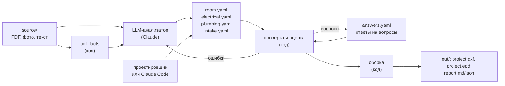

# Как устроена Shtroba

Карта системы: откуда берутся данные, кто что считает (код или LLM) и в какой функции.
Состояние работ и планы — в [status.md](status.md). Меняешь, где считается что-то из
таблиц ниже, — поправь и этот файл.

## Поток данных

Главное правило: **LLM только читает источники и пишет модель (YAML).** Всё, что можно
посчитать, считает код, без LLM и без API-ключей: проверку, геометрию, площади, листы,
таблицы. Одна и та же модель всегда даёт один и тот же чертёж.

Модель — единственный источник правды. DXF и `.epd` — результат сборки, из них ничего не
считается (обратный путь из DXF — будущая команда `update`).

## Пакеты и слои

Код ядра — `src/floorplan_engine/`, пакеты по смыслу, слоями сверху вниз; выше может
импортировать ниже, не наоборот (import-linter, контракты в `pyproject.toml`,
`uv run lint-imports`):

| Слой | Что | Модули |
| --- | --- | --- |
| `cli/` | команды, печать, коды выхода | — |
| `service/` | API (`api/`: app, viewer, viewer_db, work, auth), анализ (`analysis/`: analyzer, llm_analyzer, промпт, pdf_facts), разбор источников (`facts/`), база (`db/`), workflow, storage | — |
| `pipeline/` | конвейер без вывода: оценка, отчёт, DXF, `.epd`, черновик задач монтажа (`work_plan`) | — |
| `epd/` | артефакт для просмотра | artifact, objects, side, scene3d, panel_data, thumbnail, plumbing |
| `sheets/` | документ проекта, печать, PNG листов | document, layout, stages, printing, preview |
| `validation/` | проверка модели, вес вопросов, отчёт | validate, issues, plan, electrical, plumbing, answers, assess, report |
| `drawing/` | рисование DXF | layers, ids, symbols, fields, titleblock, tables, schedules, labels, plan, electrical, wiring, mounting, panel, elevations, lighting, plumbing |
| `plumbing/` | сантехника: сеть, слабые места, строки таблиц, смета ([plumbing.md](plumbing.md)); выше электрики — берёт её трассировку, цены, развёртки | network, rows, estimate, stages |
| `electrical/` | расчёты электрики и щита | anchors, wiring, wiring_model, boxes, chases, routing, lines, groups, point_numbers, estimate, work_scope, stages, mounting, loads, panel, panel_questions, panel_text, elevations |
| `model/` | данные проекта | schema, plumbing, intake, texts, geometry, scale, panel_catalog |

Ниже в таблицах функции записаны как `модуль.функция` (`wiring.box_wiring`); у одноимённых
модулей разных пакетов — с пакетом (`drawing.wiring.lay_out`, `electrical.wiring`). Ядро
не импортирует `service/`; `model/`, `validation/`, `electrical/` не импортируют ezdxf.
Исключений из слоёв нет: общее для расчёта и рисования лежит ниже — геометрия помещений
(`geometry.room_geometries`), масштаб листа (`scale.sheet`), якоря точек и размеры символов
(`anchors.point_anchor`, `anchors.SYMBOL_DEPTH`), ключ и цвет группы (`groups.group_key`, `colors.group_colors`);
таблицы для листа собирает рисование (`drawing/schedules.py`) из строк расчётов.

## Модель проекта (YAML)

| Файл | Что в нём | Схема |
| --- | --- | --- |
| `room.yaml` | Помещения: стены по часовой стрелке (`id`, длина, угол `turn`, толщина, несущая), проёмы (дверь, окно, проём; `offset`, ширина, петли, подоконник), язык надписей, данные штампа | `schema.Plan` |
| `studio.yaml` (над папками проектов) | Профиль студии: организация, стадия, подписи — подставляются в пустые графы `sheet` | `schema.Studio`, `answers.apply_studio` |
| `electrical.yaml` | Точки (тип, стена + `offset` + высота или потолок `[x, y]`, постов, клавиш, группа), щит, кабели (откуда, куда по порядку, группа, марка, `route`), LED-ленты | `schema.Electrical` |
| `plumbing.yaml` | Вода и канализация: стояки (`at` от origin), узел ввода, приборы у стены (тип, `offset`, высоты подводов), препятствия, разводка (`collector` / `tee`) | `plumbing.Plumbing` ([plumbing.md](plumbing.md)) |
| `intake.yaml` | Какие источники разобраны, что известно об этапах, вопросы (`target` — поле модели, `assumption` — что сейчас стоит) | `intake.Intake` |
| `answers.yaml` | Ответы: число, выбор, «принять допущение», текст; ответ заказчика — всегда текст: ждёт студию, `resolved` (учтено) или `returned` (возвращён с комментарием); `log` — кто и когда ответил и разобрал в просмотре | `intake.Answers` |

Все объекты ссылаются друг на друга по `id` (точка → стена, кабель → точки, вопрос →
поле), а не по номеру. Поэтому ссылки не ломаются, когда что-то добавили или убрали.

## Кто что делает

### Чтение источников

| Что | Кто | Где |
| --- | --- | --- |
| Масштаб листа векторного PDF (мм на pt) | код | `facts.analysis._scale`: медиана подпись ÷ длина по согласным размерам |
| Размеры: подпись, длина линии по масштабу, концы, «≠» при расхождении | код | `facts.analysis.page_facts`, `_dimension_lines`, `_centered`, `_moved_out` |
| Цепочки размеров, суммы, сверка с общим размером | код | `facts.analysis._chains`, `_overall` |
| Выбор адаптера: картинка — растр; PDF — постранично (есть векторный текст — вектор, нет — рендер и растр) | код | `facts.source.read_source` |
| Растр: OCR чисел и надписей по плиткам (+ проход по повёрнутому листу для вертикальных подписей), отрезки по Хафу с выпрямлением и склейкой; размер внутри слитой линии — между засечками у подписи | код | `facts.raster.image_sheet`, `ocr_words`, `line_segments`; `facts.analysis._centered_span` |
| Порог «не удалось»: есть ли страница с масштабом, от 4 размеров и уверенностью от 0,8; текст годится всегда; иначе `rejected` без вызова модели | код | `facts.gate.check_sources`, `workflow.Workflow._gate` |
| Точность растра против вектора (верно / ошибка OCR / пропуск / лишние, масштаб) | код | `facts.bench.compare` (команда `facts-bench`) |
| Выжимка в JSON для базы (версия алгоритма, уверенность) | код | `facts.analysis.to_dict`, `from_dict` |
| Примитивы страницы: надписи и отрезки с уверенностью (вектор — 1), общий вход разбора для любого формата | код | `facts.primitives.Sheet`; адаптер векторного PDF — `facts.vector.read_pdf` |
| Надписи с координатами, высоты «Н=…», многострочные заметки | код | `facts.vector._labels` (из символов PDF), `facts.analysis._blocks` |
| Что за комната, какой символ, к какой стене относится размер | LLM | `service/analysis/llm_analyzer.py`, правила — `service/analysis/analyzer_prompt.md` |
| Запись модели, допущения, вопросы | LLM (или человек) | то же |
| Сканы и фото (вектора нет) | LLM по картинке | то же |

Анализатор: Opus 5.5, effort `medium`, один вызов. Ошибки проверки возвращаются модели,
не больше двух исправлений. Бэкенды: `claude-code` (подписка, `claude -p`) и `api` (ключ).
Расход каждого вызова — в `usage.jsonl`. Опция `--electrical-model` — электрика вторым
шагом другой моделью.

### Проверка и оценка

| Что | Где |
| --- | --- |
| Разбор YAML, типы и обязательные поля, сообщения с путём к полю | `issues.parse_model`, `load_yaml` |
| Подстановка ответов в поля модели по `target` | `answers.apply_answers`, `intake.set_target` |
| Кому вопрос (`audience`): заказчик видит и отвечает только на свои вопросы и вопросы щита; его ответ в модель не идёт, студия отмечает «учтено» или возвращает | `pipeline.answers.for_client`, `review_answer`; `access.CLIENT_SIDE`, `CAN["review"]`; `viewer_db.shown` |
| Обход контура, замыкание, невязка ΔX/ΔY | `geometry.trace_contour` |
| Какие стены поправить, чтобы контур замкнулся («w2: 4000 → 4100») | `geometry.closure_suspects` |
| Сумма углов, самопересечения | `geometry.expected_angle_sum`, `self_intersections` |
| Проёмы: помещаются в стену, не налезают, есть подоконник | `validation.plan.check_openings` |
| Электрика: комнаты и стены существуют, точка в пределах стены, правила типов (потолок / стена, клавиши), щит, ссылки кабелей | `validation.electrical.validate_electrical`, `schema.ElectricalPoint` |
| Вес вопросов: длина и угол стены — critical без значения, major с допущением; привязки — major; прочее — minor | `assess.severity` |
| Статус этапа: строить / строить с вопросами / мало данных / данных нет (порог: один critical или больше 12 баллов) | `assess.assess` |
| Превью плана для карточки проекта в просмотре: SVG из модели (помещения, силуэт стен с проёмами, окна), цвета — классами | `thumbnail.plan_thumbnail` → `out/preview.svg` |
| Отчёт для человека и для сервиса | `report.render_markdown`, `to_json` → `out/report.md`, `report.json` |

### Сборка чертежа

| Что | Где |
| --- | --- |
| Весь конвейер: оценка → отчёт → DXF → аудит → `.epd` (PNG из DXF — только `--png`) | `pipeline.build_project` |
| Документ: модель 1:1 и лист на каждый этап | `sheets.build_project_document` |
| Стены: участки всех помещений объединяются в один силуэт (shapely), рисуется его граница отрезками — общая перегородка один раз, на стыках нет внутренних линий. Несущая стена в выпуклых углах продлевается на толщину соседней — перегородка упирается в неё торцом | `drawing.plan.draw_walls`, `wall_pieces`, `geometry.outer_corners` |
| Слой кабеля на листе проводки: вид линии по группе (свет; приборы — тяжёлая группа, только выводы или одна подписанная точка; остальное — розетки; слаботочка — по цепи), защита — диф или УЗО группы на щите (следует за схемой), маршрут | `panel.line_classes`, `drawing.wiring.cable_layer`, `layers.W_CABLES` |
| Штриховка по материалу: несущие (монолит) — частая ANSI31 × 12, перегородки — редкая × 30 | `drawing.plan.draw_walls`, `_hatch` |
| Двери (дуга по `hinge` / `swing`), окна, проёмы | `drawing.plan.draw_openings` |
| Размеры по внутренней грани | `drawing.plan.draw_dimensions` |
| Название и площадь помещения; площадь — **поле AutoCAD** от контура, пересчитывается в AutoCAD | `drawing.plan.draw_room_label`, `fields.add_area_field` |
| Экспликация помещений, итог — поле-сумма | `tables.room_schedule`, `fields.add_area_sum_field` |
| Точка электрики на стене: позиция и направление в комнату | `anchors.point_anchor` |
| Несколько точек в одном месте — стопкой от стены | `anchors.stacks`, `stack_shifts` |
| Номера точек (по помещениям, на стенах по обходу и отступу, затем потолочные) и ведомость «Точки» отдельным листом: вид, высота, количество, одинаковые точки одной строкой | `point_numbers.number_points`, `point_rows`, `points_table`; лист — `stages.points_spec` |
| Развёртки стен: что на каждой стене (проёмы, точки, щит, коробки, штробы) и рисунок со шкалами отступов и высот; листы по страницам в конце комплекта | `elevations.wall_elevations`; `drawing.elevations.elevation_panel`; лист — `stages.elevations_spec` (`SheetSpec.paged`, `paginate`); для просмотра — данными `elevations.elevation_data` (ключ `elevations` страницы `.epd`; линия к точке — из `wiring.runs`) |
| Точка на стене выше потолка — предупреждение | `validation.electrical._above_ceiling` |
| План освещения: что чем включается (`controls` или допущение по группе, помещению и подписи), цепочки света, номера, таблица «Выключатели» | `lighting.switch_links`, `draw_lighting`, `switch_table`; лист — `stages.lighting_spec`; боковая панель — `side.lighting_side_table`; проверка `controls` — `validation.electrical._check_controls` |
| Подписи точек — номера («7», соседние на стене — «7–9»), общая подпись для соседних; место — перебором вокруг символа со штрафами (чужая подпись, символ, проём, LED-лента, стена, чужое помещение, выноска через подпись или символ) плюс расстояние; рядом места нет — дальше с выноской, за контур квартиры — не дальше 6 мм листа от габарита плана (иначе раздувается вид и меняется масштаб) | `drawing.electrical.point_label`, `label_clusters`, `place_label`, `label_placer`; `labels.LabelPlacer` |
| Размеры: ряды по уровням — ряд, чьи подписи ложатся на поставленные размеры, названия помещений или стены, уходит дальше (до 4 уровней); узкая или занятая подпись — рядом вдоль линии или строкой выше | `drawing.plan.draw_dimensions`, `_place_rows`, `_moves` |
| Масштаб листа: вынос подписей электрики за план (мм листа) с масштабом не пересчитывается | `layout.view_parts`, `choose_paper_and_scale` |
| Цвет группы по её виду: свет — тёплые, розетки — холодные, силовые — красные, слаботочка — зелёные (одинаковый на всех листах и наклейках) | `colors.group_colors`, `loads.group_kind` |
| Блоки УГО (розетка, выключатель, светильники, щит…) с невидимыми атрибутами ID, H, GROUP | `symbols.define_blocks`, `drawing.electrical.insert_symbol` |
| Общие сведения о проекте для первой вкладки просмотра: объект из штампа, помещения и площади, потолок (допущение), точки по видам, щит, сантехника (приборы, вода, канализация) — ключ `overview` манифеста; сводка варианта и сравнение с соседями (один другой ответ мастера, `variants.neighbour_variants`) — там же | `overview.overview_data`; `web/src/widgets/OverviewStage` |
| Трасса под любым углом в экономе: поиск по сетке в восемь сторон без штрафа за поворот, натяжение пути (угол срезается, где отрезок не ближе 150 мм к стенам); стандарт и премиум — под 90° со штрафом за поворот; косая ручная правка — только в экономе | `routing.Router(any_angle)`, `Grid.search_any`, `Grid.pull`, `routing.is_ortho`; `wiring._manual_runs` |
| Варианты проводки (`docs/wiring-variants.md`): режим, трасса, разводка (коробки или шлейф), форма трассы, гофра (нет, на потолке, на потолке и в стенах); «как в проекте» — всё из electrical.yaml; выбранный — `variant.yaml` (листы строятся по нему; в нём же высота потолка из просмотра, `ceiling_height`), сводка режимов и выбранного — без чертежей в манифест `.epd`; правки трасс — свои у каждого варианта (`wiring.yaml`, `variants`); выбирают студия, хозяин «Моего ремонта» и клиент студии (`access.CAN["choose_variant"]`) | `variants.apply_variant`, `default_variant`, `variant_summary`; загрузка — `validate._validate_stages`; `pipeline.variant_block`, `save_variant`, `save_wiring_edits`; просмотр — мастер `web/src/widgets/Wizard` (`POST /wizard`), сводка — `web/src/widgets/VariantInfo` |
| Легенда — значок и что он значит, без количества и цветов групп (решение 2026-10-31: количество — в «Точках», цвета — в «Группах»): на листах электрики и освещения колонками у штампа; на листе проводки — наборы цветов линий (свет, розетки, силовые, слаботочка; `wiring_legend_rows`); в просмотре — сворачиваемой плашкой на чертеже из тех же примитивов листа (значок помечен `legend:<key>`) | `drawing.electrical.legend_rows`, `draw_legend`; лист — `stages.legend_columns`; просмотр — `side.legend_entries`, `side_legends`, `artifact.legend_items`, `web/src/widgets/Legend` |
| «Группы» — одна таблица на группу (решение 2026-10-31, вместо «Групп щита» и «Кабелей»): QF, назначение (из `groups` модели или составленное по точкам с «*»), автомат и мощность — с листа «Щит» (подобранное — «*»), кабель и длина без запаса — из проводки, точки; итог — длина, точки, мощность. На листе проводки и в виде «Проводка»; строка ведёт к точкам, кабелям, линиям и коробкам группы | `groups.group_rows`, `schedules.groups_table`; на лист — `stages.groups_panel` (из `wiring_panels`), в панель просмотра — `side.group_side_table` (из `wiring_tables`) |
| Проводка через коробки: помещение — отдельная зона; коробка на группу в помещении, если там свет или ≥ 2 точек; кабель только щит → коробка, щит → точка, коробка → точка; кабели коробки не выходят из её помещения, кроме ветки к выключателю за дверью: выключатель — всегда в коробке своего света, без своей коробки и линии от щита; в другое помещение — от щита через дверные проёмы или, если через дверь крюк, сквозь ненесущую стену; трасса не ближе 150 мм к стенам (кроме подхода к точке и прохода в проёме); линий в коробке (питающая + ветки) — не больше 8 (150×110, по нижней границе вводов), больше точек — коробки по зонам, каждая своей линией от щита; типоразмер — по числу линий (Ø80 до 3, 100×100 до 6, 150×110 до 8, 190×140 — только в крайнем случае); коробка у трассы по потолку — всегда на потолке, не ближе 150 мм к стенам, в центре своих точек: из мест, где сумма путей веток в обход стен с поворотами не больше чем на 10 % выше наименьшей, — ближайшее к середине точек (путь от щита место не выбирает); у трасс по полу — на стене, где путь от щита плюс ветки наименьшие | `wiring.box_wiring`, `split_points`, `box_size`, `branch_reach`, `_box_spot`; `boxes.place_ceiling_box`, `CENTER_SLACK`, `place_box`; `routing.CLEARANCE` |
| Трассировка: сетка 100 мм по помещениям и дверным проёмам (окна закрыты, 50 мм от стен), кратчайший путь со штрафом за поворот — прямые участки под 90°; путь считается раз от каждого источника. Сквозь стену между помещениями (решение 2026-11-11) — если она не несущая (`bearing`), не наружная и не толще 300 мм (или `partition: true`): проход стоит как ≈1 м кабеля (`WALL_PASS_COST`, не зависит от толщины), поэтому дверь остаётся первой, а стена — когда крюк через дверь длиннее; несущие, наружные и толстые (шахты, пилоны, короба) не сверлятся | `routing.Router`, `free_area`, `drillable_walls`, `wall_strips`, `room_area` |
| Марка кабеля без `cables` в модели (допущение, «*»): свет 3x1.5, розетки и приборы 3x2.5, слаботочка UTP / RG-6; группа с тяжёлым прибором (от 2 кВт) — сечение под автомат, который код ставит группе: варочная 7,2 кВт — 3x6 и C32, а не 3x2.5 | `wiring._mark`, `loads.heavy_cable`, `loads.cable_for` |
| Длина линии: путь по плану + подъёмы к потолку на концах (высота потолка 2700 по умолчанию, коробка на стене на 200 ниже потолка, на потолке — 0) + выпуски 2 × 200; итог по марке +15 % | `wiring_model.Run`, `Wiring.by_mark` |
| Слаботочка без группы (решение 2026-11-11): интернет и TV — каждая точка своей линией от слаботочного щита `media`, без него — от щита (допущение); группа «Связь», марка UTP cat.6 / RG-6 (допущение), в смете без цены, пока её нет в прайсе | `wiring._low_link`, `chases.wall_chases` |
| Имя стены для людей (решение 2026-11-11): код «2.В» — номер пола в экспликации и буква по обходу (кириллица без З, О, Ч и букв одного языка), описание — `walls[].name` или что за стеной и окна, двери; `w1…wN` в YAML не меняются. На плане код — внутри помещения у стены, мимо размеров, подписей, подоконников и дверей | `wall_names.wall_codes`, `wall_names.wall_names`, `plan.draw_wall_codes` |
| Штробы по стенам: спуски к точкам (общая штроба, если ближе 150 мм, до 4 кабелей; длина — до самой дальней точки), у щита, слаботочного щита и коробок; силовые и слаботочка, потолок и пол — раздельно; узкая (до 2 кабелей) / широкая; материал стены (`walls[].material` или `default_wall_material`) — у каждой штробы, смета считает по нему (`work.chase.concrete`…, широкая — узкая × 1,5; без материала — `work.chase` по цене кирпича с пометкой) | `chases.wall_chases`, `Chase.wide`, `chases.with_material`, `estimate.chase_quantities` |
| Кабель-канал (`cable_channels`, решение 2026-11-06): широкая штроба по стене от входа до выхода, без кабеля и линии от щита; входит в смету штроб, ведомость и развёртки | `chases.channel_chases` |
| Трасса по полу (`route: floor`): подъёмы от пола, коробки на 300 мм; отдельные линии без коробок (сечение от 4 мм², только `outlet`, слаботочка, `direct`); выпуск в щите — до пола | `wiring.box_wiring`, `_direct`, `section` |
| Ручные правки проводки (`wiring.yaml`, из просмотра): коробка — в указанное место (на стене — вдоль своей стены, не ближе 150 мм к углам; на потолке — внутри помещения, не ближе 150 мм к стенам), её линии без ручной трассы прокладываются заново; ручная трасса — ортогональная, концы пристёгиваются к узлам под прямыми углами; правка, чей id теперь означает другую линию или коробку, не применяется — предупреждение в отчёте. Проводка в `pipeline` считается в масштабе листа (`sheets.document_scale`): узлы — как на чертеже | `wiring.box_wiring`, `_moved_boxes`, `moved_anchor`, `_manual_runs`; `routing.move_end`, `fit_path`; схема — `schema.WiringEdits`, загрузка — `validate.validate_project`; запись — `pipeline.save_wiring_edits` |
| Что выделять по клику на плане: стена, её проёмы, размеры с ними, вторая сторона перегородки, накрытые ею стены; у проёма — обе стороны и размеры | `objects.plan_chains` |
| Куда клик попадает на стене плана: площади стен, как заштрихованы | `drawing.plan.wall_areas`, `objects.plan_areas` |
| Проходы через стены: трассы по потолку через двери и проёмы (пара дверь/проём — один проход); сквозь стену (`drillable_walls`) — и по потолку, и по полу, линии ближе 300 мм друг к другу — в одном отверстии. Одно отверстие на вход в помещение, сколько бы ни было кабелей (решение 2026-11-11); больше 5 (`HOLE_CABLES`) — большое, коронкой (`Hole.large`, позиция `work.wall_hole_large`: цена — обычное отверстие × 2,5, если в прайсе нет своей, `estimate.DERIVED_PRICES`); силовые и слаботочка — в разных отверстиях | `chases.passages`, `wall_holes`, `estimate.derived_quote` |
| Смета электрики на листе проводки (под таблицей «Группы»; совсем без цен — ведомость объёмов) | `schedules.estimate_table`, `stages.wiring_panels`; цены собирает `pipeline._sheet_inputs` |
| Смета электрики таблицей: объёмы из модели (кабель с запасом, подрозетники, коробки, опрессовка, крепления монтажным пистолетом — клипсы гофры по диаметру и площадки для кабеля без гофры, шаг по поверхности, штробы, механизмы, светильники и выводы, LED-лента), щит — по составу листа «Щит» (аппараты по видам и номиналам, сборка — по модулям; без щита — автомат на группу); работы — разделами «черновые» (до отделки: штробы, кабель, подрозетники, коробки, корпус щита, маркировка, замер) и «чистовые» (сборка щита, механизмы), раздел позиции — `estimate.LINES`, порядок — `SECTIONS`, итоги — `Estimate.subtotal`, `Estimate.work`; цены — сервис цен (решение 2026-11-01: внешний API или микросервис, пока имитация `MockPriceService` с типовыми ценами, строки помечены «пока имитация») под прайсом `prices.yaml` проекта или студии, который важнее (аппараты — по виду, `breaker.C16` — по номиналу); без цены — «нет цены»; out/estimate.md, .csv, .xlsx | `estimate.quantities`, `build_estimate(…, panel)`, `pricing.Prices`, `pricing.mock_price`, `pricing.price_notes`, `panel.build_panel`, `panel.device_name`, `pipeline.estimate_project` |
| Состав работ к смете («скрытых услуг» нет): по каждой работе `work.*` — что входит в цену, что не входит и где это оплачивается (ссылка на позицию этой сметы или «в смету не входит»), чем работа сдаётся; тексты — справочник `electrical/work_scope.yaml`, код только проверяет ключи и ссылки и подставляет названия позиций; `out/work-scope.md` и лист «Состав работ» в `out/estimate.xlsx` | `work_scope.load_scope`, `scope_entries`, `write_scope_markdown`, `scope_sheet`, `pipeline.write_estimate` |
| Что обговаривается с заказчиком отдельно от работ (доставка, подъём, закупка, мусор, демонтаж, отключение питания, выходные, простой, парковка, работа без электроэнергии): каталог без цен, решения студии — `terms` в прайсе; код только подставляет решения, считает фиксированные суммы и процент от материалов и перечисляет необговорённое | `terms.load_terms`, `term_rows`, `terms_markdown`, `terms_sheet_tail`, `pipeline.write_estimate` |
| Черновик задач монтажа (решение 2026-11-11, `docs/work-tasks.md`): позиции смет электрики и сантехники по этапам шаблона (каждая — ровно в одном, по базовому ключу), этап без позиций выпадает, зависимости — к его предшественникам, критерий приёмки — `result` работ из состава работ (у сантехники — свой), сумма — по строкам с ценой; ключ `work_plan` манифеста `.epd`. Задачи, статусы, факт, фото, оплаты — только в базе сервиса, их ядро не знает; суммы задач считает код сервиса из строк (`db/work.totals`), не хранит | `electrical/stages.py`, `plumbing/stages.py`, `pipeline/work_plan.py`; сервис — `service/db/work.py`, `work_records.py`, `api/work.py` |
| Лист «Проводка»: коробки, линии по цветам групп со скруглёнными поворотами (дуга R 1,5 мм листа в полилинии; длины — по ортогональной трассе); совпадающие трассы — пучком по полосам (шаг 0,7 мм, пучок не шире 14 мм листа и не ближе 150 мм к стенам, у стены сдвигается от неё; `lanes`, `clearance`, `offset_path`), подпись на отрезок пучка «L длина ×число кабелей» (`bundles`, `length_label`), спуск «↓h» к точке и подъём «↑h» от щита (места подписей — без наложений на трассы, коробки, точки и другие подписи), таблица «Группы» (итог — все группы), допущения; кабель по маркам с запасом — первые строки сметы под ней; кабельный журнал CSV; ведомость штроб `wiring-chases.csv` и итог на листе | `drawing.wiring.draw_wiring`, `schedules.groups_table`, `write_journal` |
| Раскладка листа (одна для всех): четыре секции, крест — в левом верхнем углу штампа: план (по центру, ≈ 94 % секции) · таблицы (прижаты вправо, одна под другой; не влезли — колонками справа налево, лишние колонки забирают место у секции плана) / легенда (слева от штампа, его высоты) · штамп. Бумага (формат и ориентация) — одна на комплект | `layout.grid`, `place`, `arrange`, `columns`, `stack_right`, `fit_legend` |
| Щит в просмотре: свой компонент из ключа `panel` страницы — корпус — реальный щит каталога в натуральную величину (`enclosure`: Hager Golf, рейки по шагу 125 мм, пустые тоже видны); рейки по видам кладёт бэк (`row` у аппарата, `panel.panel_rows`: вверху общие — ввод, реле, ПЗІП, АВР, питание инвертора; ниже автоматы на гребёнке, дифавтоматы на двойной гребёнке L + N; аппарат не выходит за рейку), аппарат — отрисовщиком по модели каталога (`бренд.вид` → вид → прямоугольник), центр на оси рейки; питание сверху гребёнками (стволы основной сети, резерва от АВР и N — вдоль левой стенки), провод группы — тонкой линией цвета группы из нижней клеммы в пучок под рейкой (шаг проводов — под место до следующей рейки), пучком в правую стенку, за корпусом — под углом к подписи (подписи колонкой по порядку проводов, слипшиеся — группой по центру, `layout.fan`): веер без пересечений; клеммники N и PE (вид Hager QuickConnect) по центру; резервная шина — участком гребёнки в рамке; инвертор — рисунком гибридного (пропорции 5 кВт, дисплей, клеммы снизу) над колонкой подписей, пять проводов без пересечений: GRID L, N от питания инвертора, LOAD L, N в автомат выхода инвертора QS3 (не на гребёнке), с него перемычками под рейкой во вход II АВР или переключателя, PE стволом вдоль правой стенки в клеммник PE (вилка генератора — без GRID); у инвертора — щит АКБ (`dc`) справа от колонки подписей, под инвертором: вводы инвертора — сеть слева, BAT и PV справа; провода АКБ и строк панелей — от верхних клемм своими дорожками вверх в вводы (у правого провода выше — без пересечений), под корпусом — АКБ кабелями к автомату АКБ, строки панелей — вниз и вправо к подписи, УЗИП DC — перемычками к автомату строки; клик по аппарату или строке таблицы — карточка аппарата поверх чертежа (назначение, аппарат, кабель, P, I, модель, шина, потребители, слабые места), в таблице панели колонки назначения нет; масштаб и сдвиг, подсветка — свечение аппарата, провода и строки подписи: наведённая строка таблицы — цветом `--hl`, плавное появление и пульсация (без анимации — ровное); закреплённый кликом аппарат — своим цветом `--pin`, ровно, без пульсации (ховер на других строках его не трогает), без подсказок под курсором; PNG для альбома — весь лист из примитивов | `panel_data.panel_data`, `panel_data.dc_data`, `panel.build_dc`, `panel.choose_enclosure`, `panel.panel_rows`, `panel_catalog.ENCLOSURES`, `panel_catalog.model_for`; `web/src/PanelStage.tsx`, `panel/layout.ts`, `panel/catalog.ts`, `panel/parts.ts`, `panel/painter.ts`, `panel/PanelView.ts` |
| Лист «Щит» (DXF, печать): щит в лицо — DIN-рейки по 12/18/24 модуля (аппарат не делится), аппараты по схеме `panel.scheme`, провод группы снизу к своему автомату цветом группы, подписи назначения, кабеля и мощности; резервная шина — рамкой, инвертор или вилка — справа. Рисуется на листе без видового экрана, модуль подгоняется под секцию плана | `drawing.panel.fit_panel`, `draw_panel_front`; лист — `stages.panel_spec` (`SheetSpec.body`) |
| Линия от щита — свой автомат (решение 2026-10-28): в раскладке `proper` и щите `premium` группа модели делится по линиям проводки от щита (коробка помещения или зоны, прямая линия к точке): QF1 → QF1, QF1.2…; первая линия — с записью группы из `groups`, у остальных — автомат и УЗО группы, назначение по точкам; кабели и резерв щита — на все линии; слаботочка не делится. Делится модель отчёта — щит, проводка, таблицы и смета видят одни группы; в economy и standard несколько линий от щита остаются на одном автомате | `lines.split_by_lines`; вызов — `validate._validate_stages`, `answers.auto_questions` |
| Три фазы на вводе (`panel.phases: 3`, решение 2026-11-08): ввод 3P+N, реле напряжения на каждую фазу, УЗИП 3P+N; прибор от 5 кВт (варочная панель, электрокотёл) — на три фазы, 3P-автомат или дифавтомат 3P+N, кабель 5×; остальные группы — по фазам: крупные первыми на наименее нагруженную, помещение — на своей фазе, пока она не тяжелее на 1 кВт, свет — минимум на двух фазах, резервная шина и общее УЗО эконома — на одной; фаза группы из модели (`groups.<QF>.phase`) не меняется; слабые места — фаза больше вводного, разница фаз больше 15 %, трёхфазный прибор на резерве. Фаза — в таблице «Группы», на листе и в просмотре щита (три тонкие шины над рейкой, ствол и перемычка на фазу) | `phases.assign_phases`; `loads.is_three_phase`; `panel.build_panel`, `weak_spots`; `schedules.groups_table`; `web/src/engine/panel/painter.ts` (`feeds3`) |
| Расчётный пик резервной шины (решение 2026-11-11): источник проверяется не суммой установленной мощности, а пиком — свет и постоянные приборы (холодильник, роутер, котёл, полотенцесушитель) целиком, розеточный пост типовой мощности — 30 % (`POST_SHARE`), из эпизодических приборов (микроволновка, чайник, духовка, плита, стиральная, сушильная, посудомоечная машина: `OCCASIONAL`) — один самый мощный. Слабое место `w_backup` — пик больше мощности источника; в просмотре сумма — пик против источника, от 80 % — «близко к пределу» (запас 20 % на КПД, нагрев и пуск компрессоров), установленная — мелко рядом; быстрый выбор «максимум» — тоже по пику. Вывод «вентилятор» — 50 Вт | `loads.backup_share`, `backup_peak`, `BoardPanel.reserve_peak`; `epd/panel_data.reserve_data` (`steady`, `peak`); `web/src/widgets/ReserveList/reserve.ts` |
| Мастер-выключатель (`panel.master`, решение 2026-11-09): клавиша у входа обесточивает группы `panel.master_off` (нет — все, кроме тех, где холодильник, котёл, роутер, насос, ворота, домофон, сигнализация: `loads.KEEP_ON`; смешанная группа остаётся включённой целиком — слабое место). В щите — модульный контактор на шину: KM2 основной, KM3 за АВР или переключателем резерва; группы за ним — после остальных на своей шине (у эконома своё общее УЗО); автомат цепи управления SF1 B6, при резерве — на резервной шине. Номинал контактора — ряд 25 / 40 / 63 А по расчётному току его групп, не больше вводного. Не задан — вопрос; допущение «да», если в точках есть выключатель с пометкой «мастер» / «майстер». Нет такой точки — код ставит её у щита на 900 мм (допущение и вопрос `panel_master_place`). Мастер-выключатель — аппарат управления: со светом не связывается, кабель управления 3×1,5 — своей линией от щита (группа SF1), в смете — контактор, автомат, кабель | `electrical/master.py`; `loads.panel_groups` (`PanelGroup.master`), `panel.build_panel`; `wiring.box_wiring`; `lighting.switch_links`; `epd/panel_data.master_data` |
| Вопросы щита (этап `panel`, id `panel_…`, на языке проекта, тексты — `panel_text`): резерв (`panel.backup`, допущение — инвертор), фазы на вводе (`panel.phases`, 1), ввод (`panel.input`, 63 А), состав резервной шины, мастер-выключатель (`panel.master`, что отключает — `master_off`, где стоит), разделённая перегруженная группа (мокрая — дифавтоматы), кабель тяжёлого прибора. Составляет код по расчёту, ответ value/choice подставляется в `panel` электрики, после чего вопросы составляются заново; этап «Щит» строится с электрикой и её не останавливает | `panel_questions.panel_questions`; `answers.apply_auto_answers`, `Report.questions`; `assess.assess` |
| Маркировка щита (решение 2026-11-05, в коде — stickers): на каждый аппарат вертикальная наклейка 10 × 25 мм — номер, короткое название из назначения группы или названия аппарата («что» + первое место, «+N» — ещё мест), иконка по словам назначения и виду аппарата (без LLM); название переносится по ширине шрифта, размер — наибольший, что влезает; порядок — по рейкам щита, PDF A4 в натуральную величину — `out/panel-stickers.pdf` и цветной `out/panel-stickers-color.pdf` (цвет группы, как линии на чертеже), оба ещё и с номером линии без букв — `panel-stickers-short.pdf`, `panel-stickers-color-short.pdf` (12 вместо QF12, общие аппараты — QS1 как есть), в просмотре то же кривыми, выбор — переключателями | `electrical/stickers.build_stickers`, `sheets/stickers.lay_out`, `stickers_data`, `write_stickers`; `web/src/widgets/StickersStage` |
| Нагрузка и автоматы щита: потребители по точкам (`power` или типовая по виду и `note` — допущение «*»), автомат группы — из `groups` или свет 10 / розетки 16 / тяжёлые по току, не больше рекомендуемого для сечения; коэффициент спроса квартиры; слабые места (перегруз, автомат не защищает кабель, тяжёлый в общей группе, ток квартиры выше ввода, селективность, нет реле напряжения, резерв мал, «вилка-вилка») — на лист и в отчёт; роспись — `out/panel-loads.csv` | `panel.build_panel`, `weak_spots`, `write_loads`; в отчёт — `pipeline.build_project` |
| Ширина текста на листе (таблицы, легенда, примечания, штамп, наложения подписей) — по метрикам шрифта, не по оценке | `layers.text_width`; перенос примечаний — `sheets.wrap` |
| Рамка и основная надпись по ДСТУ Б А.2.4-4:2009, форма 3 | `titleblock.draw_sheet`, `draw_stamp` |
| Масштаб — общий для комплекта, из ряда ГОСТ 2.302 и 1:30 (`scale.SCALES`): тот, при котором план ближе всего к 94 % своей секции (не больше 100 %); текст и символы рисуются под него (`sheet()`), на бумаге их размер постоянный. Видовой экран в этом масштабе, чужие слои заморожены | `sheets.choose_paper_and_scale`, `add_sheet`, `scale.drawing_scale` |
| Надписи на чертеже на `ru` / `uk` | `texts.tr` |
| `id` из YAML на каждом примитиве модели (XDATA `FLOORPLAN_ENGINE`) | `ids.tagged` |
| Аудит DXF после записи | `pipeline.save_checked` |
| PNG листов из DXF (отладка, `build --png`, `preview`) | `preview.render_png` |
| Листы в браузере: в canvas — только чертёж (видовой экран `view`), таблицы листа — в боковой панели со связью строка ↔ объекты; подсказки — только у объектов темы листа; светлая и тёмная тема; PNG листа для альбома — весь лист из canvas, не больше A3 150 dpi | `web/src/sheet/SheetView.ts`, `sheet/paint.ts`, `sheet/drawing.ts` (план, электрика, освещение и проводка — один чертёж по `model` листов; вкладка — слои своего листа, масштаб общий; 3D — на любой вкладке чертежа, со слоями вкладки; электрика, освещение и проводка — одна вкладка «Электрика» с видами по системам справа: «Свет» (кабели света или связи — переключатель над чертежом), «Розетки», «Связь», «Проводка» со всеми линиями, `tabs.ts`, `views.ts`; связи света — и в 3D, `three/lightLinks.ts`), `SidePanel.tsx` (`Tables`, `Layers` — не у щита); вопросы, исходники и проект — кнопками в шапке, `Drawer.tsx`; страницы — `viewer.sheets`, `viewer.sheet` |
| Зоны открытого помещения на плане (решение 2026-11-11): если зоны заняли все стены, у каждой — свой контур площади, подпись с площадью (поле AutoCAD), строка экспликации и карточка (`zone:<комната>.<n>`); граница зон — прямая между их крайними углами. В просмотре пол помещения или зоны под курсором заливается с плавным появлением, стены не подсвечиваются | `zones.plan_floors`, `plan.draw_plan`, `tables.room_schedule`, `side.room_table`, `objects.plan_floor_rings`, ключ страницы `floors`; фронт — `web/src/engine/sheet/floors.ts`, `SheetView.paintFloors` |
| Таблицы листа для боковой панели (экспликация, обозначения и группы, спецификация, кабели, смета) и ключи объектов у строк; объекты темы листа | `side.side_tables`, `side.STAGE_OBJECTS`; в страницу — `artifact.export_artifact` (`view_rect`, `sheets.sheet_slug`) |
| Правка трасс в просмотре (лист проводки, «Править трассы»): тянется участок линии — соседние удлиняются, углы прямые, конец с коробкой и точкой — перпендикулярный отвод; ⌘/Ctrl+клик — несколько участков (коробки — нет); коробка на стене — вдоль стены, на потолке — свободно; шаг 10 мм; отмена шага. Потребители и щит не двигаются. Данные — ключ `edit` и переход `model` страницы `.epd`; «Сохранить» → `wiring.yaml` и пересборка | `objects.wiring_handles`, `artifact.model_transform`; `web/src/edit/WiringEdit.ts`, `edit/geometry.ts` (`dragPath`, `moveEnd`); `viewer.save_wiring` |
| 3D проводки: стены призмами (над дверью перемычка, под окном подоконная часть; высоты проёмов без данных — типовые, с пометкой), общая перегородка — один кусок с нормалями двух комнат, угол на её стыке с наружной стеной — у наружной (периметр в срезе сплошной); трассы по высоте: подъём от источника, путь по потолку или полу (пучок — 15 мм между кабелями), спуск к точке у грани стены. Показ: react-three-fiber (three.js, MIT) в `web/`, отдельным файлом по первому нажатию, кнопка «3D» на листе проводки, изометрия, стены «срез» (перегородки — бортиком 300 мм, наружные — бортиком, когда стоят между камерой и помещением; стена целиком, куски не расходятся) / прозрачные / без стен, закрытая часть линии — бледно; подсказки, выделение линии, связь с таблицами — как на листе | `scene3d.build_scene` (ключ `scene` страницы, `pipeline.build_project`); `web/src/three/Scene3D.tsx` |
| Карточки объектов для подсказок: название линии по смыслу (группа: откуда → куда), автомат, кабель, длины; точки, коробки, щит, помещения, стены, проёмы; в страницу `.epd` — только её объекты; то же название — колонка `label` кабельного журнала | `objects.describe_objects`, `page_objects`, `wire_titles`; показ — `web/src/Tip.tsx` (`PageIndex.card`) |
| PNG листов для проверки — тот же `.epd`, что в браузере | `artifact.render_page_png` (команда `render-artifact`) |
| Печать: PDF-альбом в натуральную величину, проверка листа (текст ≥ 1,8 мм, за рамкой, пустой) | `printing.write_album`, `printing.check_sheets`; `pipeline.print_project` (команда `print`) |
| Комплект на заданном формате: таблицы на листы-продолжения, деление таблиц по строкам, масштаб по плану с проверкой отрисовкой | `layout.fit_specs`, `layout.paginate`, `layout.split_table`, `sheets.choose_paper_and_scale` |
| `.epd` для кабинета: примитивы каждой страницы | `artifact.export_artifact` (формат — [epd-format.md](epd-format.md)) |

### Сантехника

| Что | Где |
| --- | --- |
| Подводы приборов на стене: что нужно, Ø выпуска, типовые высоты (допущение «*»); горячая слева, холодная справа | `model/plumbing.FIXTURE_SPECS`, `network.fixture_outlets` |
| Сеть: свободная область — помещения и проёмы минус препятствия плюс перегородки (сквозь — с доплатой `Grid.penalty`, через уже пробитое трубой воды — без неё, `_open_holes`; под гипсокартонной стенкой внутри помещения (`partition: true`) — почти свободно, без отверстия, `Network.under`; отверстия — `Network.holes`); дверной проём — доплата `DOOR_COST` для воды (через дверь — только если иначе не пройти, слабое место `_check_doors`; канализации — нельзя); подход к прибору — по полу к стене, дальше в стене; прибор на коробе — через короб; вода лучевая (умывальники рядом и посудомойка от мойки — одной линией, `supply_groups`; попутная линия — тройником от соседней, если труба пропустит расход, `_merge_parallel`, `FLOW`, `CAPACITY`) или тройниковая, горячая — из стояка или от бойлера; канализация — дерево к ближайшему по пути стояку, унитазы первыми и только в Ø110 | `network.build_network`, `partition_strips`, `_approaches`, `_box_approaches`, `_riser_heads`, `route_one`, `route_tree` |
| Горячая парой с холодной (`PAIR_GAP`, `parallel`, `_pair`); канализация — своя сетка: без дверных проёмов и проёмов жилых комнат, скрытые зоны (короб, инсталляция, под ванной и поддоном — `HIDDEN_HEIGHT`) проходимы и в приоритете, цена шага — множитель по ячейке (`Grid.mult`: скрытая 0,7, у стены 1, рядом 2, посреди 4), отсечение по высоте в поиске (`height_prune`: посреди комнаты, где труба уже выше стяжки, — закрыто; запасной путь без отсечения — `FALLBACK_COST`); поиск в восемь сторон с отводами 45° (`Grid.search45`, отвод — `TURN_COST_MM` 175), изломы и врезки — `bends.octilinear`, `chamfer`, `tee45`; Ø50 в трубу унитаза — тройником 110×50 (`_into_110`), тройники Ø50 — объединением пар по экономии расхода трубы (место J — min d(A,J)+d(B,J)+k·d(J,R), вес Ø110 2,2, отвод 45° — 175 мм; недопустим, если ломает стяжку или перепад прибора или ветка посреди комнаты выше стяжки) и сборкой труб по соосной ветке (`merge_drains`, `_emit`); варианты (`SEWER_VARIANTS`): обычный, через скрытые зоны, только вдоль стен — берётся с наименьшей оценкой `sewer_score` (ошибки стяжки, подиумы, короб, середина комнаты, длина с отводами) | `sewer_grid`, `route_sewer`, `route_tree`, `merge_drains`, `_emit`, `shape45` |
| Высоты канализации обратным счётом от врезки в стояк (от плиты, `SCREED_MM`): уклон один на трубу — 0,025, у Ø110 без отводов — до 0,02, при запасе высоты — 0,03 (магистраль не положе веток); высоты — низ трубы (`riser_invert`, `outlet_invert`); спуск в стене от выпуска (`Pipe.rise`); что в стяжку не помещается у стены — по стене над полом в коробе (зона `surface`, `Pipe.surface`, примечание с высотой короба; на листе — оранжевым пунктиром, в смете — короб); проверки: Ø50 в стяжке посреди помещения (низ + Ø + `SCREED_COVER` ≤ 90), Ø110 вне скрытой зоны и не у стены, верх выше скрытой зоны, перепад (подиум), отвод унитаза > 1 м — ошибки `SewerError` и `Weak`; много отводов, жилая комната — предупреждения; трассы по зонам — `SewerRoute`, JSON — `out/sewer-routes.json` | `sewer_heights`, `_evaluate`, `Zones`, `routes_json`; файл — `pipeline.build_project` |
| Лист «Сантехника»: трубы полосами (`wiring.lanes`), приборы номерами и контуром типового размера (ванна, душ, унитаз…), стояки, коллекторы, препятствия (ванна и поддон — прибором, короб — сеткой); «Сантехприборы», «Трубы», смета, легенда | `drawing/plumbing.py`, `drawing/pipe_paths.py`, `drawing/plumbing_legend.py`, `drawing/fixture_symbols.py`, `sheets.stages.plumbing_spec` |
| Подводы на развёртках (своя развёртка у стены только с сантехникой) | `rows.water_views` → `elevations.wall_elevations(water=…)`, `drawing/elevations.py`; просмотр — `engine/elevation/ElevationView.ts` |
| Смета сантехники: объёмы из сети (вода — фитинги REHAU RAUTITAN, `water_fittings`; канализация — поворот 90° двумя отводами 45°, `network_model.drop_bends`), цены — прайс поверх сервиса (`MockPriceService.extra`) | `plumbing/estimate.py`; файлы — `pipeline.write_plumbing_estimate` → `out/plumbing-estimate.*` |
| Просмотр: карточки, таблицы, смета страницы «Сантехника», трубы в 3D-сцене | `epd/plumbing.py`; `web/src/widgets/Scene3D`, `EstimateStage` |

### Сервис

API на FastAPI ([service-api.md](service-api.md)). Проект проходит состояния:
`created → analyzing → needs_answers / needs_model → building → ready`
(или `insufficient`, `failed`). Раундов вопросов — не больше трёх.

| Что | Где |
| --- | --- |
| Маршруты: создать проект, загрузить и прочитать модель, анализ, вопросы, ответы, отчёт, файлы, источники | `service/api/app.py` |
| Рынок цен работ электрики: выборка открытых прайсов `projects/market.yaml` (решение 2026-11-03; собирают руками или агентом, у цены — источник, дата прайса и строка прайса), вилка позиции — мин, квартили, медиана, макс — и период цен (от самого раннего года до самого позднего месяца) | `market.MarketSample`, `market.item_spread`, `market.period` |
| Админка платформы (решение 2026-11-03): студии, пользователи, проекты; участники студии и проекта, приглашения, коды доступа, доступ поддержки, блокировка и выход пользователя, журнал. Только суперпользователь; изменения — по тем же правилам доступа (одно пространство на человека, у клиента один проект, у студии остаётся владелец), каждое — в журнал | `service/db/admin.py` (правила и виды), API — `/api/admin/*` (`service/api/admin.py`), доступ — `auth.Auth.check`; фронт — `admin/` (React + TypeScript, адрес `/admin/`, `admin/README.md`) |
| Настройки студии (`#@studio`, из шестерёнки): профиль фирмы (пока только просмотр) и прайс работ (`#@studio/prices`): работы `work.*` — цена студии из `prices.yaml` её папки (`access.studio_folder`; у студии корня — `projects/prices.yaml`; нет — цена сервиса цен с пометкой), вилка рынка, отклонение от медианы, сноска о периоде и источниках; правка цен — построчно в `prices.yaml` с комментариями, только студия (pro со своей студией или суперпользователь; гость отладки читает) | `pipeline.price_page`, `pipeline.save_prices`, `estimate.edit_price_items`; API — `GET`/`POST /api/prices` (`viewer.py`), доступ — `auth.Auth.check`; страница — `web/src/pages/Studio`, прайс — `web/src/widgets/PriceList` |
| Просмотр собранных `projects/` в браузере (команда `view`; запись — правки проводки в `wiring.yaml`, вариант, ответы в `answers.yaml` (`pipeline.save_answer`), мастер настройки — вариант и ответы вместе (`pipeline.save_wizard`) с пересборкой; «сборка устарела» — YAML новее `out/report.json`, а для ответов — другой `answers_digest`: текстовый ответ без разбора сборку не устаревает) | API — `service/api/viewer.py`; страница — самостоятельный проект `web/` (React + TypeScript, Vite; сборка в `web/dist`), ходит в API через прокси |
| Цикл и переходы состояний | `service/workflow.py` |
| Очередь задач, продолжение после рестарта | `service/tasks.py`, `Workflow.recover` |
| Доступ к API сервиса | `service/api/project_guard.py` |
| Хранение на диске | `service/storage.py` |
| Анализатор: ручной или LLM | `service/analysis/analyzer.py`, `llm_analyzer.py` |

### Команды CLI

`check`, `build`, `estimate`, `print`, `preview`, `render-artifact`, `analyze`, `pdf-facts`, `serve`, `view`, `symbols`
— тонкая обёртка над `pipeline/` и сервисом (`cli/`).

## Чего ещё нет

| Что | Что нужно | Где в плане |
| --- | --- | --- |
| Остальные варианты разводки: лучевая; сравнение вариантов | По образцу `wiring.box_wiring` | status.md, «Электрика: разводка и щит», п. 1 |
| Группы по умолчанию, если их нет в модели | Правило группировки (свет / розетки по помещениям) — допущение | там же |
| Однолинейная схема щита (нужна, решение 2026-10-27), система TT, счётчик в щите | Сейчас — щит в лицо (`electrical/panel.py`, одна или три фазы, TN-C-S / TN-S) | там же, п. 2–3 |
| Символы точек по легенде PDF | Распознавание кодом — точки без размеров (выключатели) ставит код | status.md, рычаги цены |
| Раздельные листы электрики | Освещение, розетки, проводка | status.md, «Дальше», п. 1 |
| Мебель, отопление | Схемы и отрисовка этапов | «Дальше», п. 4 |
| Сантехника: правка трасс в просмотре, трассы в стенах и по потолку, сверка с электрикой | По образцу `wiring.yaml` и проверок электрики | [plumbing.md](plumbing.md), «Дальше» |
| Правки из DXF обратно в модель | Команда `update` по `id` в XDATA | «Дальше», п. 6 |
| Продакшен сервиса | Авторизация, очередь, база, ключ API | «Дальше», п. 5 |
