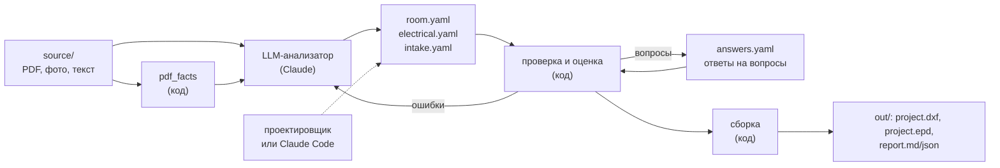

# Как устроена Штроба

Карта системы: откуда берутся данные, кто что считает (код или LLM) и в какой функции.
Состояние работ и планы — в [status.md](status.md). Меняешь, где считается что-то из
таблиц ниже, — поправь и этот файл.

## Поток данных

Главное правило: **LLM только читает источники и пишет модель (YAML).** Всё, что можно
посчитать, считает код, без LLM и без API-ключей: проверку, геометрию, площади, листы,
таблицы. Одна и та же модель всегда даёт один и тот же чертёж.

Модель — единственный источник правды. DXF и `.epd` — результат сборки, из них ничего не
считается (обратный путь из DXF — будущая команда `update`).

## Модель проекта (YAML)

| Файл | Что в нём | Схема |
| --- | --- | --- |
| `room.yaml` | Помещения: стены по часовой стрелке (`id`, длина, угол `turn`, толщина, несущая), проёмы (дверь, окно, проём; `offset`, ширина, петли, подоконник), язык надписей, данные штампа | `schema.Plan` |
| `studio.yaml` (над папками проектов) | Профиль студии: организация, стадия, подписи — подставляются в пустые графы `sheet` | `schema.Studio`, `validate.apply_studio` |
| `electrical.yaml` | Точки (тип, стена + `offset` + высота или потолок `[x, y]`, постов, клавиш, группа), щит, кабели (откуда, куда по порядку, группа, марка, `route`), LED-ленты | `schema.Electrical` |
| `intake.yaml` | Какие источники разобраны, что известно об этапах, вопросы (`target` — поле модели, `assumption` — что сейчас стоит) | `intake.Intake` |
| `answers.yaml` | Ответы: число, выбор, «принять допущение», текст | `intake.Answers` |

Все объекты ссылаются друг на друга по `id` (точка → стена, кабель → точки, вопрос →
поле), а не по номеру. Поэтому ссылки не ломаются, когда что-то добавили или убрали.

## Кто что делает

### Чтение источников

| Что | Кто | Где |
| --- | --- | --- |
| Масштаб листа векторного PDF (мм на pt) | код | `facts.analysis._scale`: медиана подпись ÷ длина по согласным размерам |
| Размеры: подпись, длина линии по масштабу, концы, «≠» при расхождении | код | `facts.analysis.page_facts`, `_dimension_lines`, `_centered`, `_moved_out` |
| Цепочки размеров, суммы, сверка с общим размером | код | `facts.analysis._chains`, `_overall` |
| Выбор адаптера: картинка — растр; PDF — постранично (есть векторный текст — вектор, нет — рендер и растр) | код | `facts.source.read_source` |
| Растр: OCR чисел и надписей по плиткам (+ проход по повёрнутому листу для вертикальных подписей), отрезки по Хафу с выпрямлением и склейкой; размер внутри слитой линии — между засечками у подписи | код | `facts.raster.image_sheet`, `ocr_words`, `line_segments`; `facts.analysis._centered_span` |
| Порог «не удалось»: есть ли страница с масштабом, от 4 размеров и уверенностью от 0,8; текст годится всегда; иначе `rejected` без вызова модели | код | `facts.gate.check_sources`, `workflow.Workflow._gate` |
| Точность растра против вектора (верно / ошибка OCR / пропуск / лишние, масштаб) | код | `facts.bench.compare` (команда `facts-bench`) |
| Выжимка в JSON для базы (версия алгоритма, уверенность) | код | `facts.analysis.to_dict`, `from_dict` |
| Примитивы страницы: надписи и отрезки с уверенностью (вектор — 1), общий вход разбора для любого формата | код | `facts.primitives.Sheet`; адаптер векторного PDF — `facts.vector.read_pdf` |
| Надписи с координатами, высоты «Н=…», многострочные заметки | код | `facts.vector._labels` (из символов PDF), `facts.analysis._blocks` |
| Что за комната, какой символ, к какой стене относится размер | LLM | `service/llm_analyzer.py`, правила — `service/analyzer_prompt.md` |
| Запись модели, допущения, вопросы | LLM (или человек) | то же |
| Сканы и фото (вектора нет) | LLM по картинке | то же |

Анализатор: Opus 5.5, effort `medium`, один вызов. Ошибки проверки возвращаются модели,
не больше двух исправлений. Бэкенды: `claude-code` (подписка, `claude -p`) и `api` (ключ).
Расход каждого вызова — в `usage.jsonl`. Опция `--electrical-model` — электрика вторым
шагом другой моделью.

### Проверка и оценка

| Что | Где |
| --- | --- |
| Разбор YAML, типы и обязательные поля, сообщения с путём к полю | `validate.parse_model`, `load_yaml` |
| Подстановка ответов в поля модели по `target` | `validate.apply_answers`, `intake.set_target` |
| Обход контура, замыкание, невязка ΔX/ΔY | `geometry.trace_contour` |
| Какие стены поправить, чтобы контур замкнулся («w2: 4000 → 4100») | `geometry.closure_suspects` |
| Сумма углов, самопересечения | `geometry.expected_angle_sum`, `self_intersections` |
| Проёмы: помещаются в стену, не налезают, есть подоконник | `validate.check_openings` |
| Электрика: комнаты и стены существуют, точка в пределах стены, правила типов (потолок / стена, клавиши), щит, ссылки кабелей | `validate.validate_electrical`, `schema.ElectricalPoint` |
| Вес вопросов: длина и угол стены — critical без значения, major с допущением; привязки — major; прочее — minor | `assess.severity` |
| Статус этапа: строить / строить с вопросами / мало данных / данных нет (порог: один critical или больше 12 баллов) | `assess.assess` |
| Отчёт для человека и для сервиса | `report.render_markdown`, `to_json` → `out/report.md`, `report.json` |

### Сборка чертежа

| Что | Где |
| --- | --- |
| Весь конвейер: оценка → отчёт → DXF → аудит → `.epd` (PNG из DXF — только `--png`) | `pipeline.build_project` |
| Документ: модель 1:1 и лист на каждый этап | `sheets.build_project_document` |
| Стены: участки всех помещений объединяются в один силуэт (shapely), рисуется его граница отрезками — общая перегородка один раз, на стыках нет внутренних линий. Несущая стена в выпуклых углах продлевается на толщину соседней — перегородка упирается в неё торцом | `draw_plan.draw_walls`, `wall_pieces`, `geometry.outer_corners` |
| Штриховка по материалу: несущие (монолит) — частая ANSI31 × 12, перегородки — редкая × 30 | `draw_plan.draw_walls`, `_hatch` |
| Двери (дуга по `hinge` / `swing`), окна, проёмы | `draw_plan.draw_openings` |
| Размеры по внутренней грани | `draw_plan.draw_dimensions` |
| Название и площадь помещения; площадь — **поле AutoCAD** от контура, пересчитывается в AutoCAD | `draw_plan.draw_room_label`, `fields.add_area_field` |
| Экспликация помещений, итог — поле-сумма | `tables.room_schedule`, `fields.add_area_sum_field` |
| Точка электрики на стене: позиция и направление в комнату | `draw_electrical.point_anchor` |
| Несколько точек в одном месте — стопкой от стены | `draw_electrical.stacks`, `stack_shifts` |
| Подписи точек «2× h300 …» без наложений, общая подпись для соседних | `draw_electrical.point_label`, `label_clusters`, `place_label` |
| Цвет группы (одинаковый на листах электрики и проводки) | `draw_electrical.group_colors` |
| Блоки УГО (розетка, выключатель, светильники, щит…) с невидимыми атрибутами ID, H, GROUP | `symbols.define_blocks`, `draw_electrical.insert_symbol` |
| Легенда: символы и счёт точек по группам | `draw_electrical.legend_rows` |
| Спецификация изделий: механизмы, подрозетники по постам, рамки по постам, светильники, LED в метрах, щит | `specification.specification` |
| Группы щита отдельной таблицей: QF, назначение (из `groups` модели или составленное по точкам с «*»), кабель, точки, аппарат (только из модели); в легенде — только «QF4» и цвет | `groups.group_rows`, `groups_table`; на лист — `sheets.groups_panel`, в панель просмотра — `side.group_side_table` |
| Проводка через коробки: помещение — отдельная зона; коробка на группу в помещении, если там свет или ≥ 2 точек; кабель только щит → коробка, щит → точка, коробка → точка; кабели коробки не выходят из её помещения, кроме ветки к выключателю за дверью: выключатель — всегда в коробке своего света, без своей коробки и линии от щита; в другое помещение — от щита через дверные проёмы; трасса не ближе 150 мм к стенам (кроме подхода к точке и прохода в проёме); линий в коробке (питающая + ветки) — не больше 8 (150×110, по нижней границе вводов), больше точек — коробки по зонам, каждая своей линией от щита; типоразмер — по числу линий (Ø80 до 3, 100×100 до 6, 150×110 до 8, 190×140 — только в крайнем случае); место — по сумме путей веток в обход стен с поворотами, а не по прямой; коробка — на стене, а если линии из неё расходятся на 90° и больше (точки не только на её стене) — на потолке внутри помещения, в самом выгодном месте; у трасс по полу — всегда на стене | `wiring.box_wiring`, `split_points`, `box_size`, `branch_reach`, `_box_spot`, `fan_angle`, `_place_ceiling_box`; `routing.CLEARANCE` |
| Трассировка: сетка 100 мм по помещениям и дверным проёмам (стены и окна закрыты, 50 мм от стен), кратчайший путь со штрафом за поворот — прямые участки под 90°; путь считается раз от каждого источника | `routing.Router`, `free_area`, `room_area` |
| Длина линии: путь по плану + подъёмы к потолку на концах (высота потолка 2700 по умолчанию, коробка на стене на 200 ниже потолка, на потолке — 0) + выпуски 2 × 200; итог по марке +15 % | `wiring.Run`, `Wiring.by_mark` |
| Штробы по стенам: спуски к точкам (общая штроба, если ближе 150 мм, до 4 кабелей; длина — до самой дальней точки), у щита и коробок; силовые и слаботочка, потолок и пол — раздельно; узкая (до 2 кабелей) / широкая | `wiring.wall_chases`, `Chase.wide` |
| Трасса по полу (`route: floor`): подъёмы от пола, коробки на 300 мм; отдельные линии без коробок (сечение от 4 мм², только `outlet`, слаботочка, `direct`); выпуск в щите — до пола | `wiring.box_wiring`, `_direct`, `section` |
| Ручные правки проводки (`wiring.yaml`, из просмотра): коробка — в указанное место (на стене — вдоль своей стены, не ближе 150 мм к углам; на потолке — внутри помещения), её линии без ручной трассы прокладываются заново; ручная трасса — ортогональная, концы пристёгиваются к узлам под прямыми углами; правка, чей id теперь означает другую линию или коробку, не применяется — предупреждение в отчёте. Проводка в `pipeline` считается в масштабе листа (`sheets.document_scale`): узлы — как на чертеже | `wiring.box_wiring`, `_moved_boxes`, `moved_anchor`, `_manual_runs`; `routing.move_end`, `fit_path`; схема — `schema.WiringEdits`, загрузка — `validate.validate_project`; запись — `pipeline.save_wiring_edits` |
| Проходы через стены: трассы по потолку через двери и проёмы (пара дверь/проём — один проход), до 4 кабелей в отверстии | `wiring.passages`, `wall_holes` |
| Смета электрики на листе проводки (под таблицей кабелей; без прайса — ведомость объёмов) | `estimate.estimate_table`, `sheets.wiring_panels`; прайс читает `pipeline.build_project` |
| Смета электрики таблицей: объёмы из модели (кабель с запасом, подрозетники, коробки, опрессовка, крепления, штробы, автоматы, модули щита, механизмы), цены — `prices.yaml` проекта, без цены — «нет цены»; out/estimate.md и .csv | `estimate.quantities`, `build_estimate`, `pipeline.estimate_project` |
| Лист «Проводка»: коробки, линии по цветам групп со скруглёнными поворотами (дуга R 1,5 мм листа в полилинии; длины — по ортогональной трассе); совпадающие трассы — пучком по полосам (шаг 0,7 мм, пучок не шире 14 мм листа и не ближе 150 мм к стенам, у стены сдвигается от неё; `lanes`, `clearance`, `offset_path`), подпись на отрезок пучка «L длина ×число кабелей» (`bundles`, `length_label`), спуск «↓h» к точке и подъём «↑h» от щита (места подписей — без наложений на трассы, коробки, точки и другие подписи), таблица по группам (итог — все группы), таблица «Кабель по маркам» (длина, с запасом 15 %, «Всего»), допущения; кабельный журнал CSV; ведомость штроб `wiring-chases.csv` и итог на листе | `draw_wiring.draw_wiring`, `wiring_table`, `marks_table`, `write_journal` |
| Раскладка листа (одна для всех): четыре секции, крест — в левом верхнем углу штампа: план (по центру, ≈ 94 % секции) · таблицы (прижаты вправо, одна под другой; не влезли — колонками справа налево, лишние колонки забирают место у секции плана) / легенда (слева от штампа, его высоты) · штамп. Бумага (формат и ориентация) — одна на комплект | `sheets.grid`, `place`, `arrange`, `columns`, `stack_right`, `fit_legend` |
| Ширина текста на листе (таблицы, легенда, примечания, штамп, наложения подписей) — по метрикам шрифта, не по оценке | `layers.text_width`; перенос примечаний — `sheets.wrap` |
| Рамка и основная надпись по ДСТУ Б А.2.4-4:2009, форма 3 | `titleblock.draw_sheet`, `draw_stamp` |
| Масштаб — общий для комплекта, из ряда ГОСТ 2.302 и 1:30 (`layers.SCALES`): тот, при котором план ближе всего к 94 % своей секции (не больше 100 %); текст и символы рисуются под него (`sheet()`), на бумаге их размер постоянный. Видовой экран в этом масштабе, чужие слои заморожены | `sheets.choose_paper_and_scale`, `add_sheet`, `layers.drawing_scale` |
| Надписи на чертеже на `ru` / `uk` | `texts.tr` |
| `id` из YAML на каждом примитиве модели (XDATA `SHTROBA`) | `ids.tagged` |
| Аудит DXF после записи | `pipeline.save_checked` |
| PNG листов из DXF (отладка, `build --png`, `preview`) | `preview.render_png` |
| Листы в браузере: в canvas — только чертёж (видовой экран `view`), таблицы листа — в боковой панели со связью строка ↔ объекты; подсказки — только у объектов темы листа; светлая и тёмная тема; PNG листа для альбома — весь лист из canvas, не больше A3 150 dpi | `web/src/sheet/SheetView.ts`, `sheet/paint.ts`, `SidePanel.tsx` (`Tables`); страницы — `viewer.sheets`, `viewer.sheet` |
| Таблицы листа для боковой панели (экспликация, обозначения и группы, спецификация, кабели, смета) и ключи объектов у строк; объекты темы листа | `side.side_tables`, `side.STAGE_OBJECTS`; в страницу — `artifact.export_artifact` (`view_rect`, `sheets.sheet_slug`) |
| Правка трасс в просмотре (лист проводки, «Править трассы»): тянется участок линии — соседние удлиняются, углы прямые, конец с коробкой и точкой — перпендикулярный отвод; ⌘/Ctrl+клик — несколько участков (коробки — нет); коробка на стене — вдоль стены, на потолке — свободно; шаг 10 мм; отмена шага. Потребители и щит не двигаются. Данные — ключ `edit` и переход `model` страницы `.epd`; «Сохранить» → `wiring.yaml` и пересборка | `objects.wiring_handles`, `artifact.model_transform`; `web/src/edit/WiringEdit.ts`, `edit/geometry.ts` (`dragPath`, `moveEnd`); `viewer.save_wiring` |
| 3D проводки: стены призмами (над дверью перемычка, под окном подоконная часть; высоты проёмов без данных — типовые, с пометкой), общая перегородка — один кусок с нормалями двух комнат; трассы по высоте: подъём от источника, путь по потолку или полу (пучок — 15 мм между кабелями), спуск к точке у грани стены. Показ: react-three-fiber (three.js, MIT) в `web/`, отдельным файлом по первому нажатию, кнопка «3D» на листе проводки, изометрия, стены «срез» (ближние к камере — бортиком 300 мм) / прозрачные / без стен, закрытая часть линии — бледно; подсказки, выделение линии, связь с таблицами — как на листе | `scene3d.build_scene` (ключ `scene` страницы, `pipeline.build_project`); `web/src/three/Scene3D.tsx` |
| Карточки объектов для подсказок: название линии по смыслу (группа: откуда → куда), автомат, кабель, длины; точки, коробки, щит, помещения, стены, проёмы; в страницу `.epd` — только её объекты; то же название — колонка `label` кабельного журнала | `objects.describe_objects`, `page_objects`, `wire_titles`; показ — `web/src/Tip.tsx` (`PageIndex.card`) |
| PNG листов для проверки — тот же `.epd`, что в браузере | `artifact.render_page_png` (команда `render-artifact`) |
| `.epd` для кабинета: примитивы каждой страницы | `artifact.export_artifact` (формат — [epd-format.md](epd-format.md)) |

### Сервис

API на FastAPI ([service-api.md](service-api.md)). Проект проходит состояния:
`created → analyzing → needs_answers / needs_model → building → ready`
(или `insufficient`, `failed`). Раундов вопросов — не больше трёх.

| Что | Где |
| --- | --- |
| Маршруты: создать проект, загрузить и прочитать модель, анализ, вопросы, ответы, отчёт, файлы, источники | `service/app.py` |
| Просмотр собранных `projects/` в браузере (команда `view`; запись — только правки проводки в `wiring.yaml` с пересборкой; «сборка устарела» — YAML новее `out/report.json`) | API — `service/viewer.py`; страница — самостоятельный проект `web/` (React + TypeScript, Vite; сборка в `web/dist`), ходит в API через прокси |
| Цикл и переходы состояний | `service/workflow.py` |
| Хранение на диске | `service/storage.py` |
| Анализатор: ручной или LLM | `service/analyzer.py`, `llm_analyzer.py` |

### Команды CLI

`check`, `build`, `estimate`, `preview`, `render-artifact`, `analyze`, `pdf-facts`, `serve`, `view`, `symbols`
— тонкая обёртка над `pipeline.py` и сервисом (`cli.py`).

## Чего ещё нет

| Что | Что нужно | Где в плане |
| --- | --- | --- |
| Остальные варианты разводки: лучевая, шлейф через подрозетники; сравнение вариантов | По образцу `wiring.box_wiring` | status.md, «Электрика: разводка и щит», п. 1 |
| Группы по умолчанию, если их нет в модели | Правило группировки (свет / розетки по помещениям) — допущение | там же |
| Щит как данные, однолинейная схема | Блок `panel` в `electrical.yaml`, проверка номиналов, лист схемы | там же, п. 2–3 |
| Символы точек по легенде PDF | Распознавание кодом — точки без размеров (выключатели) ставит код | status.md, рычаги цены |
| Раздельные листы электрики | Освещение, розетки, проводка | status.md, «Дальше», п. 1 |
| Мебель, вода и канализация | Схемы и отрисовка этапов | «Дальше», п. 4 |
| Правки из DXF обратно в модель | Команда `update` по `id` в XDATA | «Дальше», п. 6 |
| Продакшен сервиса | Авторизация, очередь, база, ключ API | «Дальше», п. 5 |
