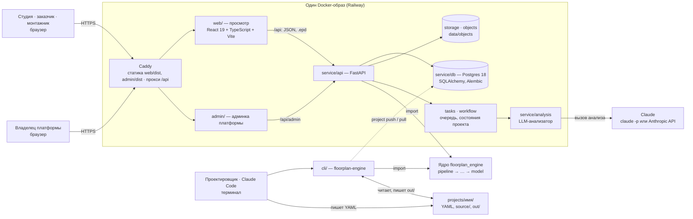
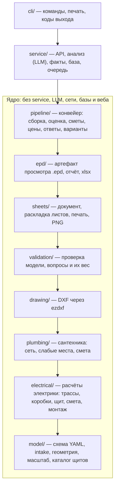
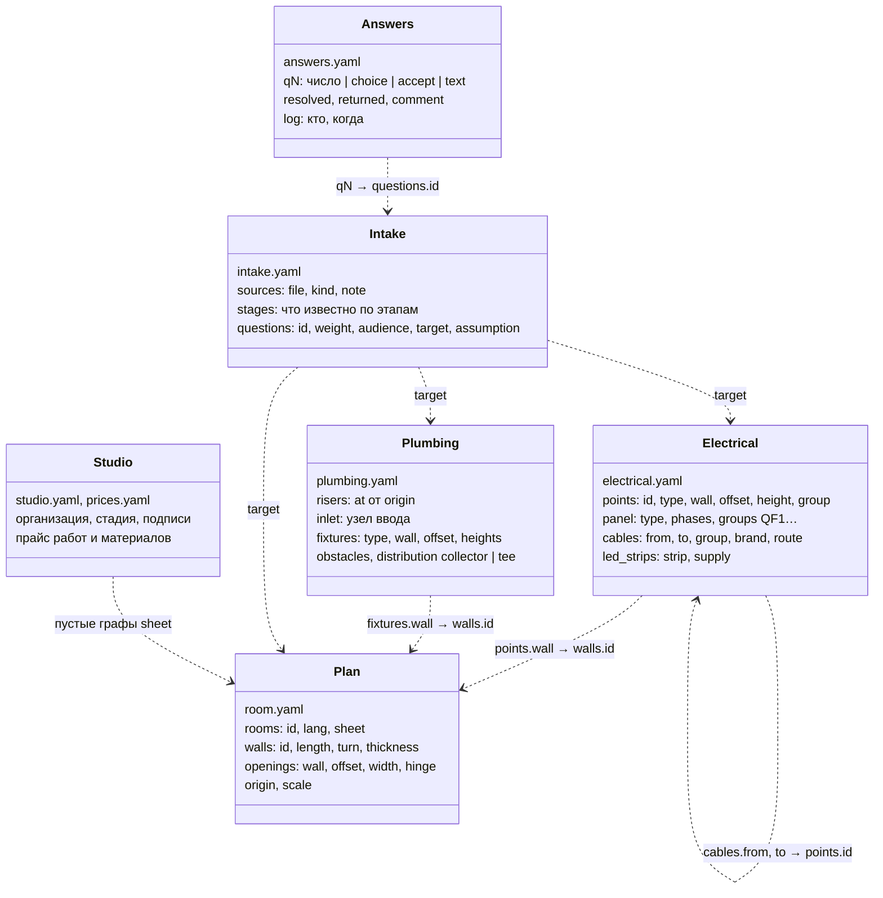
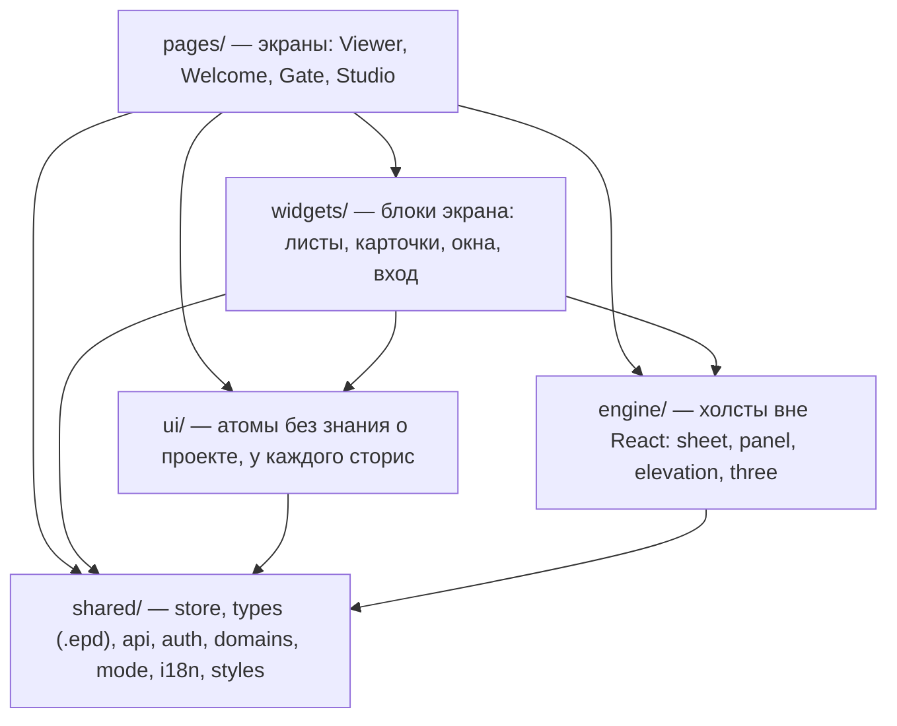
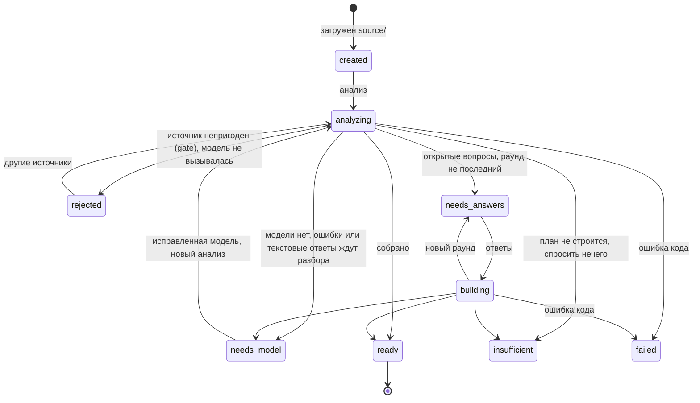

# Схемы системы

UML-схемы Shtroba в Mermaid: GitHub, VS Code и просмотр артефактов рисуют их сами. Это карта
для холодного читателя: что из чего состоит, кто с кем говорит и через какие состояния
проходит проект. Поток данных и таблица «кто что считает» — в [architecture.md](architecture.md),
модули по файлам — в [modules.md](modules.md).

**Схемы сверяются с кодом тестом `tests/test_diagrams.py`**: порядок слоёв — с контрактом
import-linter в `pyproject.toml`, состояния проекта — с `service/models.ProjectState`, группы
фронта и их импорты — с `web/src/structure.test.ts`, классы модели — с `model/`. Поменял слой,
состояние, группу фронта или файл модели — тест упадёт, пока схема не обновлена. Схему
контейнеров тест не проверяет: новый контейнер (сервис, хранилище, внешняя система) или новое
ребро между ними дописывай руками в том же изменении.

## Контейнеры

Два пути к одному ядру. Проектировщик работает с папкой `projects/<имя>` через CLI,
пользователи сервиса ходят из браузера в FastAPI, и правда для них лежит в Postgres. Боевой
образ один: Caddy отдаёт собранные `web/dist` и `admin/dist` и проксирует `/api`.

LLM есть только в `service/analysis`; ядро не знает ни о сервисе, ни о сети, ни о базе
(контракты import-linter). Просмотр читает только `.epd`, из DXF ничего не считается обратно.

## Слои ядра

Пакеты `src/floorplan_engine/` лежат слоями: выше может импортировать ниже, не наоборот,
исключений нет (`uv run lint-imports`). Сантехника выше электрики: берёт её трассировку,
цены и развёртки.

`model/`, `validation/`, `electrical/` и `plumbing/` не импортируют ezdxf: модель, проверку и
расчёты можно гонять в тестах без чертежа. Общее для расчёта и рисования лежит ниже, в `model/`.

## Модель проекта

Пять файлов YAML в папке проекта, все ссылки между ними по `id`, а не по номеру: вставка стены
или точки ничего не ломает, а ответ на вопрос знает, в какое поле модели ему ложиться
(`target`). Пунктир — зависимость по ссылке или подстановка.

`Plan`, `Electrical`, `Studio` — `model/schema.py`; `Plumbing` — `model/plumbing.py`; `Intake`,
`Answers` — `model/intake.py`. Рядом лежат `wiring.yaml` (ручные правки трасс) и `variant.yaml`
(вариант проводки из просмотра): модель они не меняют, их пишет не человек.

## Фронт web/

Самостоятельный проект: в Python нет ни HTML, ни статики. Стрелка — разрешённый импорт через
`@/` (`web/src/structure.test.ts`); внутри своей группы импорт разрешён всем, кроме `ui/`.

Холсты живут вне React: лист рисуется тысячами объектов и перерисовывается при каждом
движении. `shared/types.ts` описывает формат `.epd` и держится в согласии с
[epd-format.md](epd-format.md) руками. Админка `admin/` устроена так же, отдельным проектом.

## Состояния проекта в сервисе

`service/workflow.py`: анализ может кончиться вопросами, а не моделью; сборка детерминирована
и падает только на ошибке кода. Раундов вопросов не больше трёх (`MAX_ROUNDS`), потом проект
собирается по допущениям. Занятые состояния — `analyzing` и `building`: второй запуск в них
получает конфликт.

В режиме базы новая версия модели (push, ответ или мастер в просмотре) пересобирает проект
`project_store.build`; это не меняет `ProjectState`, «сборка устарела» считается по дате YAML
и `answers_digest`.
