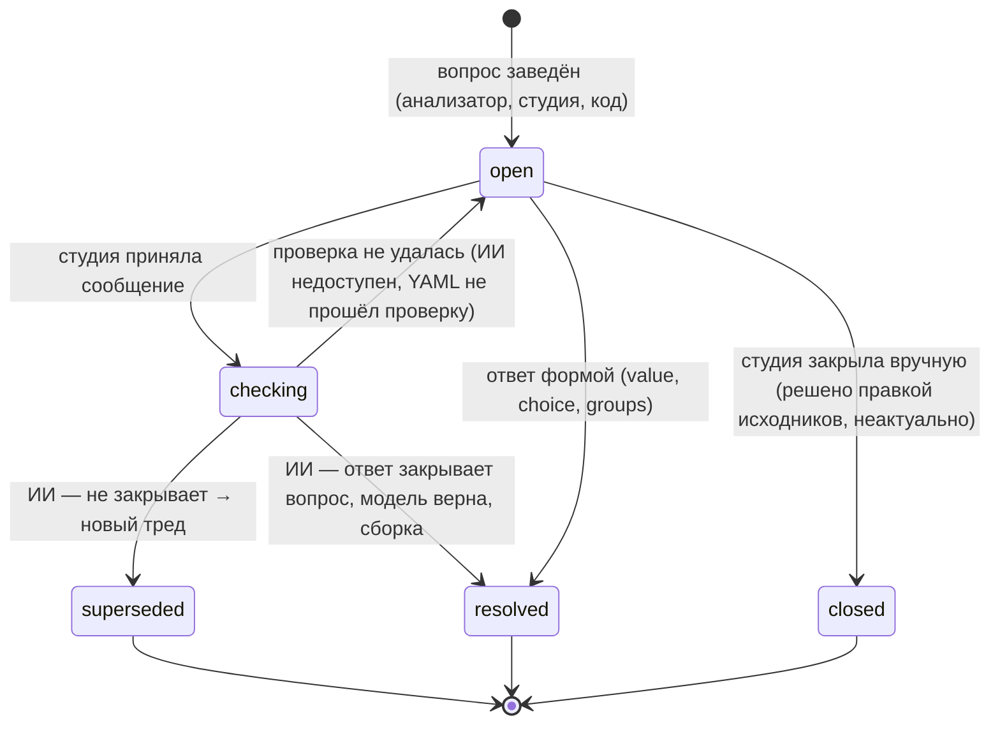
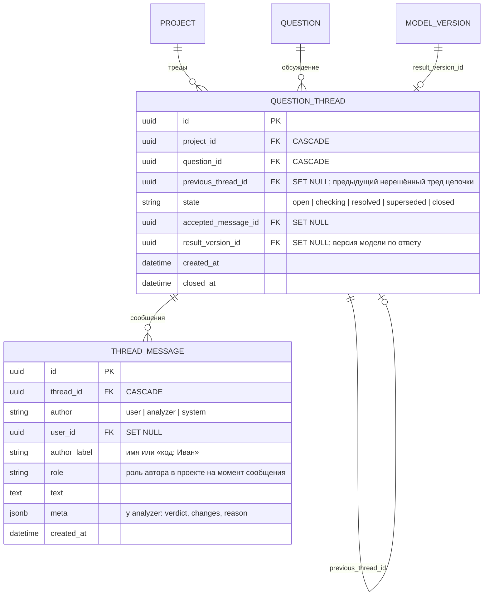

# Вопросы и ответы тредами (план, 2026-11-28)

Статус: **сделано 2026-11-28 (шаги 1–5).** Это
шаг 2 из `docs/database.md` («Вопросы и ответы»): шаг 1 — вопросы и ответы в таблицах
`question`, `question_revision`, `answer_revision` (миграция `0017`) — сделан. После реализации
правила переезжают в `database.md`, `service-api.md`, `analyzer_prompt.md`, а этот файл удаляется
или остаётся историей решения.

## Решения (2026-11-28)

1. **Вопрос — это тред.** Ответ не одно поле, а обсуждение: сообщения адресата и студии. Любое
   сообщение треда можно «Принять как ответ».
2. **Принятый ответ проверяет ИИ.** Если ответ закрывает вопрос, ИИ переносит его в модель,
   ядро проверяет результат, получается новая версия модели и пересборка. Если не закрывает —
   тред закрывается как «не решён», и открывается новый тред с цитатой принятого ответа и новым
   вопросом. Цикл повторяется, пока вопрос не решён.
3. **Три адресата:** `client` (заказчик), `installer` (монтажник), `studio` (проектировщик:
   толщина стен, неясная дверь, вопросы кода). Сейчас адресатов два, `studio | client`; значение
   `installer` добавляется.
4. **«Принять как ответ» нажимает только студия** (право `review`: `owner`, `designer`,
   `superuser`) — для любого адресата. Это **меняет решение 2026-11-11** («ответ заказчика чертёж не
   меняет»): теперь ответ заказчика меняет чертёж, но только после согласия студии и проверки ИИ.
   Сам по себе, без студии, ответ заказчика или монтажника модель не трогает.
5. **Число, выбор, группы щита у вопросов студии** (`value`, `choice`, `groups`, вопросы кода
   `panel_…`, `heating_…`) отвечаются формой, как сейчас: значение подставляется сразу, без ИИ. Тред
   под таким вопросом нужен только для обсуждения и закрывается, когда ответ формой сохранён. Через
   ИИ идут текстовые ответы и любые ответы заказчика и монтажника: их вопросы только уточняют
   (`target` нет), варианты `choice` у них — подсказки для сообщения.

## Состояния треда



- «Ждёт ответа», «есть ответ» — не состояния, а вывод из сообщений: последнее сообщение от
  адресата — студии пора решать; от студии — ждём адресата. По этому выводу работают счётчики.
- Сбой проверки не пропадает тихо: в тред пишется системное сообщение с причиной, студия может
  принять снова.
- Защиты от бесконечного цикла кодом нет, это решение (п. 2). Студия видит длину цепочки
  («3-й тред по вопросу») и может закрыть её вручную.

## Данные (миграция `0022`)



- **Один открытый тред на вопрос.** Новый тред цепочки — это **новый вопрос** (новый `qid`,
  `source = analyzer`) со ссылкой `previous_thread_id`. Старый вопрос получает ревизию с новой
  причиной `superseded` и уходит из `intake.yaml`, как снятый.
- `question.audience`: допустимые значения — `studio | client | installer`.
- **YAML на границе не меняется.** `intake.yaml` и `answers.yaml` по-прежнему собираются из
  таблиц (`questions.texts`). Принятый и решённый ответ ложится в `answers.yaml` как
  `{ text: <принятое сообщение>, resolved: true }`. Сборка, `push` и `pull` тредов не знают. У
  `pull` треды в папку не выгружаются.
- **Перенос.** Миграция переносит текстовые ответы из `answer_revision`: тред с одним сообщением
  автора; комментарий `returned` — вторым сообщением студии; `resolved` — тред `resolved`
  (проверку ИИ задним числом не делаем). Ответы формой — тред `resolved` без сообщений.
- **Просмотр над папкой** (`view` без базы) тредов не получает и работает с файлами, как сейчас.

## Проверка ответа ИИ

Новый шаг анализатора `check_answer` в `service/analysis/`. Использует те же бэкенды, что
`llm_analyzer.py` (`claude -p` по подписке или API по ключу), расход пишется в `usage`. Правила
шага — новый раздел «Проверка ответа» в `analyzer_prompt.md`, здесь их не дублируем.

**На входе:** вопрос (текст, `stage`, `target`, `assumption`, адресат), все сообщения треда с
ролями авторов, отмеченное принятое сообщение, цитаты предыдущих тредов цепочки, текущая модель
(YAML этапа вопроса) и ошибки её проверки.

**На выходе** (JSON, как конверт анализатора):

```json
{
  "verdict": "satisfied",
  "reason": "ответ даёт длину стены w2",
  "changes": ["room.yaml: w2.length 4000 → 4100"],
  "files": [{"name": "room.yaml", "content": "…"}],
  "followup": null
}
```

```json
{
  "verdict": "unsatisfied",
  "reason": "сказано «как на кухне», но размер кухни тоже не известен",
  "files": [],
  "followup": {"text": "Какая ширина проёма в кухню, мм?", "audience": "client",
               "severity": "critical", "stage": "plan"}
}
```

**Что делает код:**

1. `satisfied`: файлы пишутся во временную папку модели, ядро проверяет их
   (`validate_project`). Новых ошибок нет — новая версия модели (`author = analyzer`, связана с
   тредом через `result_version_id`), ответ становится `resolved`, сборка в очереди. Новая ошибка —
   один повтор с ошибками в контексте, как у раундов анализатора; не помогло — тред `open` и
   системное сообщение с ошибкой.
2. `unsatisfied`: тред `superseded`; новый вопрос и тред с `previous_thread_id`, первое сообщение
   цитирует принятый ответ; адресат — из `followup`, по умолчанию прежний.
3. В тред пишется сообщение `analyzer` с `reason` и `changes`: студия видит, что ИИ поменял в
   модели.
4. Одна проверка на проект за раз (очередь, как у сборки); пока идёт проверка, остальные треды
   принимать можно, они встают в очередь.

Ядро не меняется: ИИ живёт только в `service/analysis/`, результат — тот же YAML через ту же
проверку (CLAUDE.md).

## Права и видимость

| Кто | Видит треды | Пишет | Принимает / закрывает |
| --- | --- | --- | --- |
| заказчик (`client`, `client_code`) | `audience: client` | в свои | — |
| монтажник (`installer`) | `audience: installer` | в свои | — |
| студия (`owner`, `designer`, `superuser`) | все | во все | да (`review`) |

- Фильтр по адресату — рядом с нынешним `for_client` (`pipeline.answers`). Добавляется
  `for_installer`.
- Право `answer` получает `installer`, но только на вопросы монтажнику.

## API (база; `docs/service-api.md` — при реализации)

| Метод | Что |
| --- | --- |
| `GET /api/projects/{key}/threads` | треды, видимые роли: вопрос, состояние, последние сообщения, длина цепочки |
| `GET /api/projects/{key}/threads/{id}` | тред целиком и цепочка предыдущих |
| `POST /api/projects/{key}/threads/{id}/messages` | `{text}` — сообщение (право `answer` или `review`) |
| `POST /api/projects/{key}/threads/{id}/accept` | `{message_id}` → `202`, тред `checking` (право `review`) |
| `POST /api/projects/{key}/threads/{id}/close` | `{comment?}` → `closed` (право `review`) |

- Ответ формой — прежний `POST …/answers`: он же закрывает тред вопроса.
- `POST …/answers/review` (учтено / вернуть) удаляется: его заменяют «Принять» и сообщение в треде.
- Текстовый ответ через `POST …/answers` больше не принимается: текст пишется только сообщением.

## Просмотр (`web/`)

- Виджет `Questions` становится списком тредов с вкладками по адресату (студия видит все три,
  остальные — свою). У строки — состояние и счётчик «ждёт вас».
- Карточка треда: вопрос, лента сообщений, поле ответа; у студии у каждого сообщения кнопка
  «Принять как ответ» и «Закрыть тред». Во время `checking` — индикатор и опрос состояния.
- Цепочка: ссылка «предыдущий тред» и цитата принятого ответа вверху нового.
- Вопросы с формой: форма как сейчас, лента под ней.
- Строки — через `shared/i18n/` (ru, uk, en).

## Уведомления

Первый шаг — счётчик в просмотре: «ждёт вашего ответа» для адресата, «ждёт решения» для
студии. Письмо-дайджест (SMTP есть) и Telegram — отдельным шагом, по решению 2026-11-11 (один
ведущий на проект).

## Порядок работ

1. **Бэк, данные — сделано (2026-11-28):** миграция `0022` (номер `0021` занял срок доступа),
   модели, `service/db/threads.py` (заведение тредов при `questions.ingest` и `record_code`,
   сообщения, принятие, закрытие, `follow_up`, перенос), значение `installer` у адресата (ядро:
   вопрос монтажнику уточняет, как вопрос заказчику; `pipeline.for_installer`), тесты на
   синтетике. Проверка: тексты YAML из таблиц после миграции совпадают со снимками — тест и копия
   локальной базы. Правила — в `database.md`, «Вопросы и ответы», «Треды».
2. **Бэк, проверка ИИ — сделано (2026-11-28):** раздел «Проверка ответа» и адресат `installer`
   в `analyzer_prompt.md`, шаг `service/analysis/check_answer.py`, очередь и применение —
   `service/answer_check.py` (`AnswerChecks.check_thread(project_id, thread_id)` — точка для
   API шага 3), повтор, follow-up, сбой → `reopen`. Очередь — одна проверка на проект на всех
   серверах: advisory-блокировка проекта в Postgres, работа — из базы, обход тредов `checking`. Тесты — с поддельной моделью (без токенов).
   Правила — в `database.md`, «Треды», «Проверка ИИ».
3. **Бэк, API и права — сделано (2026-11-28):** `service/api/viewer_threads.py`, право `answer`
   у монтажника на его вопросы, фильтр по стороне в карточке проекта, `service-api.md`. Писать
   можно только в открытый тред (решение 2026-11-28): остальные только читаются, `409`. Принять
   нельзя только вопрос студии с ответом формой; вопрос заказчику и монтажнику любого вида
   (`choice`, `value` без `target`) отвечается сообщением и проходит проверку ИИ. Проверка
   подключена в `create_viewer` (`checks`: старт и остановка вместе с приложением); бэкенд —
   `SHTROBA_ANSWER_CHECK` (`claude-code` | `api`), не задан — принять нельзя, `503`.
4. **Фронт — сделано (2026-11-28):** виджеты `Threads` и `ThreadCard`, `shared/threads.ts`,
   `shared/threadList.ts`, переводы, Storybook, тесты. Просмотр над папкой — по-старому.
5. **Документы — сделано (2026-11-28):** `database.md`, `service-api.md`, `architecture.md`,
   `modules.md`, `diagrams.md`, CLAUDE.md (раздел «Ответы»). Старые `POST …/answers/review` и
   текстовый ответ через `POST …/answers` остаются для просмотра над папкой.

## Открыто

- Свободный тред без вопроса (`question_id` пустой), из `database.md`, — не в этом шаге; столбец
  можно сразу сделать допускающим пустое значение.
- Вложения (фото) в сообщениях: монтажнику, скорее всего, понадобятся. Хранилище объектов есть
  (`data/objects`). Предлагается отдельным шагом.
