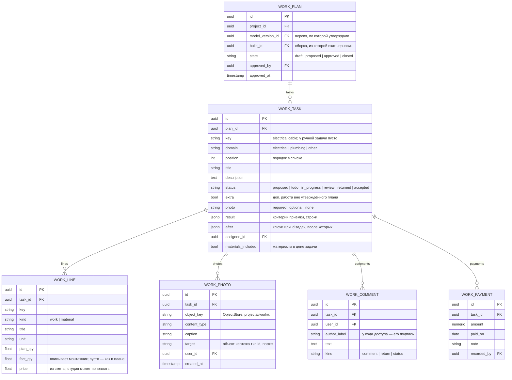
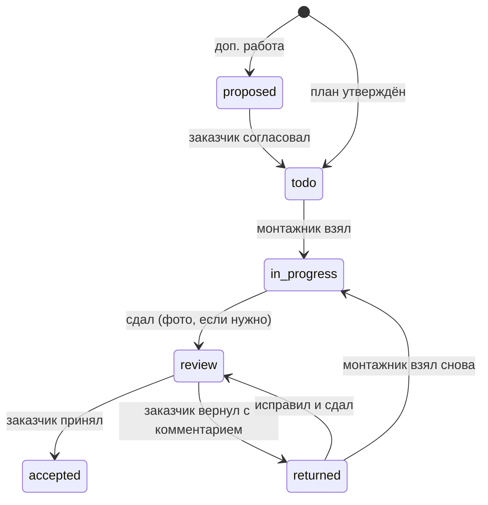

# Монтаж по задачам

Решение 2026-11-11. Статус: бэк сделан (шаг 1: черновик в ядре, таблицы, права, API, тесты);
фронт сделан (шаг 2, 2026-11-12: вкладка «Задачи», доска, список, карточка — раздел «Просмотр»). Отличия от первоначального проекта — раздел «Как сделано на бэке» в конце; доработка бэка 2026-11-12 (галочки приёмки, студия за заказчика, объединение задач) — раздел «Доработка бэка».

Утверждённый с заказчиком проект делится на задачи монтажа: «Штробы и подрозетники»,
«Прокладка кабеля», «Установка щита», «Опрессовка водопровода»… Задача — карточка как в
трекере: исполнитель, статус, позиции с ценой, план и факт, фото, комментарии, оплаты, история.
Монтажник сдаёт задачу с фото, заказчик принимает или возвращает с комментарием, студия
отмечает оплату — идут дальше.

Зачем Штробе: фото открытых штроб до штукатурки, привязанные к проекту, — исполнительная
документация «что в стене», которую клиенту больше никто не даёт; сумма этапа и критерий
приёмки уже есть в смете и в составе работ (`electrical/work_scope.yaml`, поле `result`).

## Кто что считает

| Что | Где | Почему |
| --- | --- | --- |
| Черновик задач: какие позиции сметы в какой задаче, порядок, зависимости, критерий приёмки, нужно ли фото | ядро, детерминированно: `electrical/stages.py` + `stages.yaml`, `plumbing/stages.py` + `stages.yaml`, сборка — `pipeline/work_plan.py`; результат — ключ `work_plan` в `.epd` | это свойство проекта и сметы, как `work-scope.md`; одна и та же модель даёт один и тот же черновик |
| Задачи, статусы, факт, цены после правки, фото, комментарии, оплаты | только база сервиса (`service/db/`), фото — `ObjectStore` | это состояние работ, а не модель квартиры: в `projects/<имя>/` и в YAML его нет |

Ядро о задачах в базе не знает. Сервис черновик не пересчитывает: берёт `work_plan` из `.epd`
последней сборки.

## Черновик из сметы

Шаблон этапов — данные (`stages.yaml` рядом с модулем), каждая позиция сметы (базовый ключ,
`split_key`) входит ровно в один этап; тест проверяет, что все ключи `LINES` разложены и
лишних нет (как `missing_scope` у состава работ). Позиция, которой нет в смете проекта, в
задачу не попадает; этап без позиций в черновик не попадает.

Электрика (`electrical/stages.yaml`; `prefix.*` — все ключи с этим началом):

| # | Этап (`key`) | Работы | Материалы | Фото при сдаче | После |
| --- | --- | --- | --- | --- | --- |
| 1 | Штробы, проходы, подрозетники (`chases`) | `work.chase`, `work.chase_wide` (обе — с материалом стены: `work.chase.brick`…), `work.wall_hole`, `work.wall_hole_large`, `work.socket_box` | `socket_box` | `optional` | — |
| 2 | Прокладка кабеля (`cable`) | `work.cable` (маркировка концов входит в неё: `work.marking` снят 2026-11-11), `work.conduit` | `cable`, `conduit`, `conduit_joint`, `conduit_entry`, `conduit_clip`, `cable_pad` | `required`: трассы до штукатурки | 1 |
| 3 | Распаечные коробки (`boxes`) | `work.junction_box` | `junction_box`, `junction_box_ip`, `crimp` | `optional` | 2 |
| 4 | Установка корпуса щита (`board`) | `work.board_install` | `board_enclosure`, `dc_enclosure` (щит АКБ) | `optional` | — |
| 5 | Замер изоляции (`insulation`) | `work.insulation_test` | — | `required`: протокол, фото или PDF | 2, 3 |
| 6 | Черновой свет (`rough_light`) | `work.rough_light`, `work.rough_switch` | `rough_holder`, `rough_lamp`, `rough_switch` | `none` | 2 |
| 7 | Сборка щита (`assembly`) | `work.board_module` | `breaker`, `diff`, `rcd`, `input`, `relay`, `spd`, `changeover`, `ats`, `contactor`, `feed`, `output`, `dc_battery`, `dc_breaker`, `dc_spd` | `optional` | 4, 5 |
| 8 | Механизмы и светильники (`devices`) | `work.mechanism`, `work.led_psu`, `work.led_psu_din` | `socket`, `switch1`, `switch2`, `pass_switch`, `data`, `tv`, `frame`, `light`, `downlight`, `pendant`, `sconce`, `led_output`, `outlet`, `led_strip`, `led_psu`, `led_psu_din` | `optional` | 7 |

Сантехника (`plumbing/stages.yaml`):

| # | Этап (`key`) | Работы | Материалы | Фото | После |
| --- | --- | --- | --- | --- | --- |
| 1 | Штробы и проходы под трубы (`chases`) | `work.chase_pipe`, `work.chase_sewer`, `work.chase_sewer_floor`, `work.wall_hole` | — | `optional` | — |
| 2 | Канализация (`sewer`) | `work.sewer_pipe`, `work.riser_tee`, `work.sewer_box` | `sewer.*` | `optional` | 1 |
| 3 | Водопровод (`water`) | `work.input`, `work.water_pipe`, `work.water_outlet` | `water.*` | `required`: трубы до стяжки | 1 |
| 4 | Опрессовка водопровода (`pressure`) | `work.pressure_test` | — | `required`: манометр | 3 |

«Да» первоначальной таблицы стало `optional`, «да, обязательно» и протокол — `required`, «нет» —
`none`. Критерий приёмки электрики — `result` работ этапа из `work_scope.yaml`; у сантехники
состава работ нет, критерий записан у каждого этапа в `plumbing/stages.yaml`. Этапа без позиций
в смете нет, и задачи после него идут после его предшественников: нет коробок — замер изоляции
после прокладки кабеля, нет корпуса щита — сборка щита после замера.

Правда — `stages.yaml` и тест полноты (`tests/electrical/test_stages.py`,
`tests/plumbing/test_stages.py`); таблица выше — их копия на 2026-11-11. Этапы двух разделов в плане идут одним списком, у каждой задачи
`domain`: `electrical` | `plumbing`. Электрика и сантехника друг от друга не зависят.

Вариант проводки (`variant.yaml`) черновик меняет только через смету: нет гофры — нет
`work.conduit`, нет чернового света — нет этапа 6. Порядок «до или после штукатурки»
(`plaster`) в MVP не меняет этапы; штукатурка — не наша работа и задачей не бывает.

### Ключ `.epd` `work_plan`

```json
{
  "work_plan": {
    "currency": "UAH",
    "tasks": [
      {
        "key": "electrical.cable",
        "domain": "electrical",
        "order": 2,
        "title": "Прокладка кабеля",
        "after": ["electrical.chases"],
        "photo": "required",
        "result": ["кабель лежит по трассе и закреплён, …"],
        "lines": [
          {"key": "work.cable", "kind": "work", "title": "Прокладка кабеля", "unit": "м",
           "qty": 609.4, "price": 34, "sum": 20719.6}
        ],
        "work_total": 29860.6,
        "material_total": 59012.2,
        "unpriced": 0
      }
    ]
  }
}
```

Тексты — на языке проекта. `price: null` — цены нет в прайсе («цена уточняется»), сумма
считается без неё и задача помечена (`unpriced` — строк без цены). Валюта — валюта смет
(`грн`). Ключ необязательный, поэтому `FORMAT_VERSION` не повышался (`docs/development.md`;
повышение отрезало бы просмотр от всех сборок до правки `web/`). Формат — `docs/epd-format.md`.

## Задача в базе



Сумма задачи — Σ по строкам `(fact_qty ?? plan_qty) × price`, работы и материалы отдельно;
материалы входят в сумму, если `materials_included`. Сумма не хранится, её считает код.
Оплачено — Σ `work_payment`; «оплачено» на карточке, когда оплачено ≥ суммы. Аванс — это просто
оплата до приёмки.

### Жизнь плана

1. Студия: «Создать задачи из сметы» — `work_plan` в состоянии `draft` из последней сборки,
   задачи из `.epd` `work_plan`. Студия правит: объединяет, переименовывает, меняет цены,
   добавляет свои задачи, назначает монтажника.
2. Студия: «Отправить заказчику» → `proposed`. Заказчик видит план и общую сумму.
3. Заказчик: «Утвердить» → `approved`, задачи — `todo`. План запоминает версию модели.
4. Модель после утверждения меняется — план остаётся на своей версии; новая работа — задача
   с `extra: true`, она начинается в `proposed`, пока заказчик не согласит цену.
5. Все задачи приняты и оплачены — студия закрывает план (`closed`).

Один активный план на проект (MVP).

### Статусы задачи



- Сдать задачу с `photo: required` без фото нельзя (ошибка с текстом для пользователя).
- Вернуть — только с комментарием.
- `after` — мягкая зависимость: карточка показывает «ждёт: Прокладка кабеля», взять её в
  работу может студия, монтажник — нет.
- Каждая смена статуса — строка `work_comment` с `kind: status` и запись в `audit_event`.

## Права

Новые действия в `service/db/access.py`:

| Действие | Кто | Что |
| --- | --- | --- |
| `view` (есть) | все роли проекта | видеть план и задачи |
| `work_do` | owner, designer, installer, superuser | взять, сдать, факт по строкам, фото, комментарий |
| `work_accept` | owner, designer, client, client_code, superuser | утвердить план, принять, вернуть, согласовать доп. работу, комментарий |
| `work_manage` | owner, designer, superuser | создать план, править задачи и цены, назначить, удалить, оплаты, закрыть план |

Код просмотра (`viewer`) только смотрит. Удалить фото может его автор и студия.

Студия за заказчика (решение 2026-11-12): у владельца и дизайнера есть `work_accept`, но
утвердить план, согласовать доп. работу, принять или вернуть задачу они могут только за
заказчика и только указав, как он подтвердил: `on_behalf: phone | telegram | other` и
необязательная `note`. Без канала — отказ; заказчик (`client`, `client_code`) канал не шлёт.
Канал виден в ленте задачи и в плане («принято студией за заказчика — по звонку») и пишется в
журнал.

## API

Только в режиме базы (`service/api/viewer_db.py`); у просмотра папок (`view` без базы) задач
нет, вкладка скрыта (`GET /api/projects/{key}` отдаёт `work: false`).

| Метод | Путь | Право | Что |
| --- | --- | --- | --- |
| GET | `/api/projects/{key}/work` | view | план, задачи со строками, суммами, фото (метаданные), комментариями, оплатами; `draft_available` |
| POST | `/api/projects/{key}/work/plan` | work_manage | создать план из черновика последней сборки |
| POST | `/api/projects/{key}/work/plan/{action}` | по действию | `propose` (manage), `approve` (accept), `close` (manage) |
| POST | `/api/projects/{key}/work/tasks` | work_manage | новая задача; после утверждения — `extra: true` |
| PATCH | `/api/projects/{key}/work/tasks/{id}` | work_manage | название, описание, порядок, исполнитель, `materials_included`, `photo`, `after` |
| DELETE | `/api/projects/{key}/work/tasks/{id}` | work_manage | только `todo` / `proposed` без фото и оплат |
| POST | `/api/projects/{key}/work/tasks/{id}/merge` | work_manage | `{into}`: влить задачу в другую, пока деньги открыты |
| POST | `/api/projects/{key}/work/tasks/{id}/lines/move` | work_manage | `{line_ids, to_task}`: перенести строки, пока деньги открыты |
| PATCH | `/api/projects/{key}/work/tasks/{id}/checks` | work_do, work_accept | `{index, checked}`: галочка критерия приёмки |
| POST | `/api/projects/{key}/work/tasks/{id}/status` | по переходу | `{to, comment?, on_behalf?, note?}` |
| PATCH | `/api/projects/{key}/work/tasks/{id}/lines/{line}` | work_do (факт), work_manage (цена) | `{fact_qty?, price?}` |
| POST | `/api/projects/{key}/work/tasks/{id}/lines` | work_manage | своя строка |
| POST | `/api/projects/{key}/work/tasks/{id}/photos` | work_do, work_accept | multipart, до 15 МБ, jpeg/png/webp/heic, pdf (протокол) |
| GET | `/api/projects/{key}/work/photos/{id}` | view | файл |
| DELETE | `/api/projects/{key}/work/photos/{id}` | автор, work_manage | |
| POST | `/api/projects/{key}/work/tasks/{id}/comments` | work_do, work_accept | `{text}` |
| POST | `/api/projects/{key}/work/tasks/{id}/payments` | work_manage | `{amount, paid_on, note?}` |
| DELETE | `/api/projects/{key}/work/payments/{id}` | work_manage | |

Ошибки — по-русски, как у остальных ручек просмотра. Деньги в ответе — числа, формат — на фронте.

## Фото

`ObjectStore` (`service/objects.py`): в разработке и сейчас на сервере — `LocalObjectStore`
(том Railway), позже R2/S3 за тем же протоколом, код задач не меняется. Ключ —
`projects/<project id>/work/<task id>/<photo id>.<ext>` (функция `work_photo_key` рядом с
`source_key`). Удаление проекта удаляет и префикс `work/`. Превью, EXIF-поворот и сжатие — шаг 2.

## Просмотр (`web/`)

Вкладка «Монтаж» рядом с листами; есть, когда `work: true`.

- **Студия** (`STUDIO_ROLES`) — доска: колонки «К работе / В работе / На приёмке / Возвращено /
  Принято», переключатель «электрика / сантехника / всё». Сверху — прогресс: принято N из M,
  оплачено X из Y.
- **Заказчик** (`CLIENT_SIDE`) — список по порядку работ, крупно: статус, сумма, что нужно от
  него («Примите работу», «Согласуйте доп. работу»). С телефона.
- **Карточка задачи** (боковая панель, на телефоне — весь экран): описание, критерий приёмки
  чекбоксами, строки план/факт/цена/сумма, фото (загрузка `accept="image/*,application/pdf"`,
  `capture` на телефоне), комментарии лентой, оплаты, кнопки по роли и статусу, «ждёт: …».
- Пустое состояние у студии — «Создать задачи из сметы»; у заказчика — «Студия ещё готовит
  план работ».
- Строки — через `shared/i18n` (ru, uk, en).

Как сделано (шаг 2, 2026-11-12; устройство — `web/README.md`):

- Вкладка называется «Задачи», а не «Монтаж»: «Монтаж» — уже подпись листа монтажа
  (`stage.mounting`), две вкладки с одним именем путались бы.
- Что показывать, решают только флаги `can` ответа (`shared/work.ts`): доска — у `work_manage`
  или `work_do`, список — у остальных (заказчик, код просмотра). Заказчик не видит черновик, который
  студия ещё не отправила: для него это «Студия ещё готовит план работ».
- План до утверждения — одна колонка «Предложено» в порядке работ; после — колонки по статусам,
  «Предложено» — только пока есть доп. работа на согласовании. Студия с `work_accept` (владелец,
  дизайнер) видит и «Утвердить план», и «Принять» / «Вернуть»: так дают флаги.
- Критерий приёмки — чекбоксы для проверки по пунктам; с 2026-11-12 галочки сохраняются (ниже).
- Фото: на телефоне (грубый указатель) — две кнопки: «Сфотографировать» (`capture="environment"`)
  и «Выбрать файлы» (без `capture`, несколько), иначе с камерой нельзя выбрать готовое фото;
  на компьютере — одна. Файл больше 15 МБ отказан до отправки; 413 / 415 — словами по файлу.
  HEIC и PDF — плиткой с расширением (большинство браузеров HEIC не показывает).
- Своё фото удаляет автор: id учётки страница берёт из `GET /api/auth/me` (`Account.id`).
- Не сделано на фронте: превью фото — шаг 3 (порядок, `after` и объединение — 2026-11-12, ниже).

## Как сделано на бэке (шаг 1, 2026-11-11)

Код: ядро — `electrical/stages.py` (+ `stages.yaml`), `plumbing/stages.py` (+ `stages.yaml`),
`pipeline/work_plan.py`, ключ `work_plan` манифеста; сервис — таблицы и миграция `0013`
(`docs/database.md`), правила — `service/db/work.py` и `work_records.py`, API —
`service/api/work.py` (контракт — `docs/service-api.md`, «Монтаж по задачам»), права —
`work_do`, `work_accept`, `work_manage` в `service/db/access.py`, ключи фото —
`objects.work_photo_key`. Отличия от проекта выше:

- `FORMAT_VERSION` не повышен: ключ необязательный (см. выше).
- Задачи черновика идут одним списком по номеру этапа, при равном — сначала электрика (штробы
  обоих разделов — первыми); `order` — номер этапа в шаблоне своего раздела.
- До утверждения задачи плана — в статусе `proposed`; `approve` переводит их в `todo`. Статусы
  меняются только в утверждённом плане; фото и оплаты — тоже после утверждения; в закрытом
  плане ничего не меняется.
- Деньги (цены строк, свои строки, `materials_included`) меняются, пока план не утверждён, и у
  доп. работы до согласования; после — `409` «сумма задачи согласована с заказчиком».
  Название, описание, порядок, исполнитель, `photo` и `after` — всегда, пока план не закрыт.
- Добавлено к API: `POST /work/plan/discard` — удалить ещё не утверждённый план (пересоздать
  черновик после пересборки); `after` в `PATCH` задачи (ссылки на задачи плана); в ответе —
  `waiting`, `money_editable`, суммы задачи и плана, `assignees` (для студии) и `can`. Каждая
  запись отвечает всем состоянием, как `GET /work`.
- `close` проверяет, что все задачи приняты и оплачены (`paid ≥ total`).
- Удалить фото: автор — пока задача не принята; студия — всегда. У кода доступа учётки нет:
  его фото удаляет только студия. Комментарий и фото с кода подписаны «код: <подпись>»,
  утверждение планом с кода — `approved_label`.
- `work_comment.status` — новый статус у записей `status` и `return`; у плана — `currency`,
  `approved_label`, `closed_at`; у фото — `file_name`, `size`, `author_label`.
- Удаление проекта с файлами (`project_store.delete_project`, снимает и префикс `work/`)
  готово, но маршрута удаления проекта в режиме базы пока нет: ни один вызов его не делает.
- Объединять задачи студия пока не может: в API нет переноса строк между задачами (сделано
  2026-11-12, ниже).

## Доработка бэка (решения 2026-11-12)

Код: `service/db/work_tasks.py` (вынесено из `work.py`: задачи, порядок, `after`, объединение,
перенос строк, удаление), `service/db/work.py` (`on_behalf`, `set_check`), маршруты —
`service/api/work.py`, миграция `0014` (`docs/database.md`), контракт — `docs/service-api.md`.

1. **Галочки приёмки хранятся.** `work_task.checked` — номера отмеченных пунктов `result`;
   `PATCH …/tasks/{id}/checks {index, checked}` — монтажник и заказчик (`work_do`,
   `work_accept`), только в утверждённом и не закрытом плане. Галочки не сбрасываются (ни при
   возврате, ни при повторной сдаче); каждая отметка — `work_check` в журнале. Фронт пока
   держит галочки только на экране — ему нужно поле `checked` и этот маршрут.
2. **Студия за заказчика — с каналом подтверждения.** Действие `work_accept` не от заказчика
   (`client`, `client_code`) требует `on_behalf: phone | telegram | other` (+ `note`, до 500
   знаков), иначе `422`; заказчик поле не шлёт (`422`, если прислал); в переходах `work_do` оно
   тоже `422`. Хранится в записи ленты (`work_comment.on_behalf`, `on_behalf_note`), у плана
   при утверждении (`approved_on_behalf`, `approved_note`; кто — `approved_by`), в журнале.
   Фронт: студии нужно спрашивать канал перед «Утвердить план», «Согласовать», «Принять»,
   «Вернуть» — без него эти кнопки у студии теперь получают `422`.
3. **Объединение и перенос строк** — студия (`work_manage`), пока деньги обеих задач открыты
   (как цены: план не утверждён или доп. работа не согласована). `merge {into}`: строки, лента,
   пункты приёмки с галочками, описание переходят в цель, ссылки `after` на вливаемую ведут на
   цель (без ссылки цели на саму себя и без повторов); вливаемая — без фото и оплат, удаляется.
   `lines/move {line_ids, to_task}`: строки — в конец цели. Суммы считаются из строк — сами.
4. **Порядок и зависимости проверены.** Номера задач всегда 0…n−1: добавление, перестановка,
   удаление и объединение перенумеровывают весь список по текущему порядку (даже если номера
   были испорчены). `after`: только задачи этого плана, не сама задача, повтор убирается, круг —
   `422 after: зависимость по кругу: «А» → «Б» → «А»` (раньше круг проходил, а самоссылка
   давала невнятное «нет задачи»). Удаление задачи убирает ссылки на неё у других.

## Доработка фронта (2026-11-12)

Код: `web/src/shared/work.ts` (правила показа, тесты рядом), `shared/api.ts` (запросы),
`widgets/WorkConfirm`, `WorkOrder`, `WorkMerge` (новые), `WorkCard`, `WorkPlanActions`,
`WorkBoard`, `WorkList`, `WorkSummary`; устройство — `web/README.md`.

1. **За заказчика.** Кто действует за заказчика, фронт узнаёт только из `can` ответа: у студии
   (`owner`, `designer`, `superuser`) `work_accept` идёт вместе с `work_manage`, у заказчика и
   кода заказчика — без `work_do` и `work_manage` (`actsForClient`: `work_accept` и
   (`work_manage` или `work_do`)). Роли в ответе `/work` нет — см. «Чего не хватает в API».
   Студии перед «Утвердить план», «Согласовать», «Принять» и «Вернуть» (у «Вернуть» — после
   комментария) — окно «Как заказчик подтвердил?»: по звонку / в Telegram / другое и примечание
   до 500 знаков; без выбора канала кнопка выключена. Окно закрывается после ответа сервера в
   любом случае: отказ — текстом в карточке. Заказчик окна не видит и полей не шлёт. Канал из
   ответа: в ленте под записью («студия за заказчика — по звонку: звонок 12.11»), у плана — в
   шапке доски, в сводке и в списке заказчика («Утверждён студией за заказчика — в Telegram»).
2. **Галочки.** `checked` задачи — отмеченные пункты; отметка — `PATCH …/checks` у `work_do` или
   `work_accept` в утверждённом и не закрытом плане (`cardRights().tick`), иначе чекбоксы только
   для чтения (до утверждения — с пояснением). Галочка ставится на экране сразу, потом состояние
   заменяет ответ сервера; при отказе — прежние.
3. **Объединение и перенос строк** — у `work_manage`, пока деньги задачи открыты
   (`money_editable`): цели — другие задачи плана с открытыми деньгами (`mergeTargets`).
   «Объединить с…» внизу карточки: выбор задачи («2. Прокладка кабеля»), подтверждение,
   `POST …/merge`, потом открывается карточка цели; кнопка выключена с причиной — у задачи есть
   фото, оплаты или некуда влить (`mergeBlock`). В таблице строк — галочки слева; отмечена хоть
   одна — полоса «Выбрано строк: N · Перенести в… [задача] [Перенести]» (`POST …/lines/move`).
4. **Порядок и `after`** — у `work_manage` в незакрытом плане, в карточке: «Порядок 2 из 6» с
   кнопками ↑ ↓ (работают на телефоне; новая позиция — место соседа в порядке работ, `shiftTo`)
   и «После каких задач» — список названий с номерами, «Изменить» открывает галочки по другим
   задачам плана, «Сохранить» шлёт id (`PATCH after`). `after` из ответа может содержать ключи
   задач черновика (`electrical.chases`) — фронт находит задачу по id или ключу (`afterOf`).
   Круг — `422` сервера текстом в карточке. Перетаскивания нет: кнопок достаточно.

Чего не хватает в API: признака «действует за заказчика» (или роли) в ответе `/work`. Сейчас он
выводится из сочетания `can` и совпадает с правилом бэка (`work.CLIENT_ROLES`), пока не появится
роль с `work_accept` и `work_do` на стороне заказчика. Явное поле, например
`can.on_behalf: true`, сняло бы эту связку.

## Шаги

1. **Бэк** (сделан 2026-11-11): черновик в ядре (`stages.py` × 2, `stages.yaml` × 2,
   `pipeline/work_plan.py`, ключ `.epd` без смены версии), таблицы и миграция, репозиторий
   задач, права, API, тесты, доки (`modules.md`, `database.md`, `service-api.md`,
   `epd-format.md`, `status.md`).
2. **Фронт** (сделан 2026-11-12): вкладка, доска, список, карточка, загрузка фото, тесты, Storybook;
   доработка того же дня — канал «за заказчика», галочки, объединение, перенос строк, порядок, `after`.
3. Потом: привязка фото к стене на чертеже, PDF-акт по задаче, превью фото, уведомления
   (почта, Telegram), оплата через сервис.
